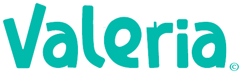

<div align="center">

<picture>
  <source media="(prefers-color-scheme: dark)" srcset="assets/valeria-logo-white.png">
  <source media="(prefers-color-scheme: light)" srcset="assets/valeria-logo.png">
  
</picture>

### 🐈‍⬛ Entiende su lenguaje, practica en casa. Lúa os acompaña

**Aplicación educativa de formación para madres, padres y cuidadores sobre el desarrollo
del lenguaje y la comunicación en la infancia, con juegos y ejercicios para practicar en casa.**
Desde octubre de 2026 la práctica se ordena alrededor de **STEAM**: el niño provoca un fenómeno
con las manos en los mundos de **Construye con Lúa**, y el lenguaje lo nombra.
Pensada también para familias de niñas y niños con hipoacusia, implante coclear, dislalias, dislexia o TEA. Offline y en el bolsillo.

<br>

<!-- Idiomas -->


<!-- Stack -->


</div>

<div align="center">
  <a href="#-qué-es-valeria"><b>¿Qué es?</b></a> ·
  <a href="#-steam-como-eje-vertebrador"><b>STEAM</b></a> ·
  <a href="#-los-seis-mundos-de-construye-con-lúa"><b>Mundos</b></a> ·
  <a href="#-realidad-aumentada-el-contrato-de-interacción"><b>RA</b></a> ·
  <a href="#-ejercicios"><b>Ejercicios</b></a> ·
  <a href="#-cuentos-pedagógicos-dialógicos"><b>Cuentos</b></a> ·
  <a href="#-academy--formación-del-cuidador"><b>Academy</b></a> ·
  <a href="#-puesta-en-marcha"><b>Puesta en marcha</b></a>
</div>

---

## 📑 Índice

**Producto**
- [¿Qué es Valeria+?](#-qué-es-valeria)
- [STEAM como eje vertebrador](#-steam-como-eje-vertebrador)
- [Los seis mundos de Construye con Lúa](#-los-seis-mundos-de-construye-con-lúa)
- [Realidad Aumentada: el contrato de interacción](#-realidad-aumentada-el-contrato-de-interacción)
- [Ejercicios](#-ejercicios)
- [Cuentos pedagógicos dialógicos](#-cuentos-pedagógicos-dialógicos)
- [Academy · formación del cuidador](#-academy--formación-del-cuidador)
- [Lúa · la mascota y la marca](#-lúa--la-mascota-y-la-marca)
- [Qué dice la evidencia y qué no](#-qué-dice-la-evidencia-y-qué-no)

**Ingeniería y calidad**
- [Puesta en marcha](#-puesta-en-marcha)
- [Sin backend: de la app no salen datos](#-sin-backend-de-la-app-no-salen-datos)
- [Refactorización en curso](#-refactorización-en-curso)
- [Historial de versiones](#-historial-de-versiones)

---

## 🐈‍⬛ ¿Qué es Valeria+?

**Valeria+ es una aplicación educativa**, no un dispositivo médico, que acompaña a las familias en la estimulación del lenguaje y la comunicación en casa. **Primero forma** con la Academy, en cápsulas de dos minutos. **Después facilita la práctica** con los mundos STEAM de Construye con Lúa, los ejercicios y los cuentos pedagógicos. El adulto guía y valida siempre. Todo funciona offline.

**Qué no es.** Valeria+ no diagnostica, no evalúa, no trata, no rehabilita y no sustituye a la logopeda, al otorrino ni a ningún otro profesional. No calcula puntuaciones clínicas ni recibe resultados de pruebas clínicas. Si una familia tiene dudas sobre el desarrollo del lenguaje de su hija o su hijo, la app le recomienda consultar con su profesional de referencia.

Valeria+ es una de las dos puertas de entrada al mismo sistema de bloques:

| Puerta | Contexto | Quién opera la tableta |
|---|---|---|
| **Valeria+** | Hogar y sesión, participación familiar | Familia o profesional |
| **Descubre con Lúa** | Escuela infantil 0–6, inglés L2 y STEAM | Docente |

> **La app decide. Lúa reacciona. Los bloques los mueve el niño. El adulto media siempre.**

---

## 🔬 STEAM como eje vertebrador

Cada actividad física se diseña empezando por un fenómeno científico o técnico que el niño provoca con las manos: una esfera que baja más rápido por una rampa más alta, un resonador que suena distinto según su forma, una viga que se inclina hacia el lado que pesa más. Después se le asignan objetivos de lenguaje, de inglés L2 mediante TPR y, cuando corresponde, de práctica de rehabilitación. El orden importa: **el fenómeno manda y el lenguaje lo nombra**.

El adulto narra y amplía. La app le sugiere palabras espaciales y de proceso ligadas a lo que acaba de pasar (dimensiones, formas, posición y dirección, orientación y transformación, cantidad, deícticos, propiedades y patrón). El niño nunca recibe listas de palabras.

Las cinco sesiones de **ciencia con las manos** que antes figuraban como siguiente iteración quedan integradas en los mundos:

| Sesión STEAM | Mundo de Construye con Lúa |
|---|---|
| Blando y duro | Set 1 · baldosas lisas y rugosas |
| La rampa | Set 3 · Laboratorio de Rampas y Gravedad |
| El sonido | Set 2 · Estación de Sonido y Eco |
| Las sombras | Set 6 · Jardín del Sol, la Sombra y la Semilla |
| Un robot que programan | Set 1 · El Camino de Lúa (algoritmos tangibles) |

Todas tienen versión para casa y versión para sesión, empiezan con aviso de seguridad, no evalúan ni registran datos de la criatura y dicen al adulto qué observar. Las órdenes en inglés (TPR) suenan en la tableta, pero el adulto media en la lengua de la familia.

---

## 🧱 Los seis mundos de Construye con Lúa

| Set | Fenómeno (manda) | Gesto principal | Uso en Valeria+ |
|---|---|---|---|
| 0 · Kit Lúa | Cuerpo de bloques de Lúa y zócalo universal con placas de identidad | Montar a Lúa | Común a todos los mundos |
| 1 · El Camino de Lúa | Orientación espacial, algoritmo tangible | Colocar baldosas, deslizar a Lúa | Rutinas de ordenación en cuatro pasos, fuerza de pinza, exploración de texturas a su ritmo |
| 2 · Estación de Sonido y Eco | El sonido es vibración | Percutir, raspar | Juegos de escucha con sonidos predecibles, segmentación silábica, pares mínimos |
| 3 · Rampas y Gravedad | Gravedad y fricción | Esperar y soltar | Autorregulación y espera estructurada, fijación visual antes de la Pizarra Mágica |
| 4 · Máquina de Soplo y Viento | Flujo de aire | Soplar | Juego de causa-efecto con el soplo y el redondeo labial, **sin finalidad terapéutica** |
| 5 · Puente de Equilibrio y Fuerza | Palanca y centro de gravedad | Colocar masas | Graduación de fuerza y pinza, conceptos opuestos en expansión semántica |
| 6 · Jardín del Sol, la Sombra y la Semilla | Crecimiento vegetal, luz y sombra | Sembrar, enroscar, interponer | Estructura sintáctica de relatos cronológicos |

Especificación completa de piezas, eventos y retos: repositorio de Construye con Lúa, `docs/SETS.md`.

---

## 🎯 Realidad Aumentada: el contrato de interacción

La RA ya no es un bloque de ejercicios aislado. Es el **lazo de cierre** entre los mundos físicos, la tableta y Lúa. La tableta actúa como sensor ciego local (ARCore + MediaPipe + Google Filament, mallas < 100 KB): solo usa magnitudes físicas (grados, latencias en ms, ratios 0,0–1,0). Cero vídeo, cero red, cero datos de los niños.

Todo mundo se especifica con la misma cadena de cinco eslabones:

```
1. EVENTO FÍSICO      el niño coloca, desliza, sopla, golpea, equilibra, enrosca
2. DETECCIÓN          RA de la tableta (marcador, mano, cara, objeto)  ó  toque del adulto
3. DECISIÓN           la app compara con el objetivo del reto
4. REACCIÓN           Lúa (opcode BLE) · luz (opcional) · Ronroneo (opcional)
5. PALABRA            voz de la tableta o frase sugerida al adulto
```

Ningún evento depende solo de la RA: el adulto siempre puede confirmarlo con un toque. Primero el fenómeno, luego una pausa breve, después Lúa y al final la palabra; la voz nunca tapa el sonido o el movimiento que el niño acaba de provocar. Ningún reto exige hablar para que Lúa reaccione: señalar, un gesto o un pictograma de CAA cuentan como respuesta. El error es neutro: el mundo muestra su consecuencia natural y Lúa queda serena. Las capas visibles de RA (aire, fuerza, sonido, luz) solo aparecen en la fase de ampliación, después de la acción.

Los antiguos ejercicios AR-1 a AR-6 pasan a ser eventos de los mundos:

| Antes | Ahora |
|---|---|
| AR-1 Orofacial | Set 4 · `S4.ROTOR_GIRA`, `S4.SOPLO_SOSTENIDO`, compuertas. El análisis facial queda en un modo de praxias aparte, con la cámara frontal y nunca a la vez que la trasera |
| AR-2 Localización | Set 3 · salida y llegada de la esfera |
| AR-3 Fijación | Set 3 · seguimiento visual de la esfera |
| AR-4 Búsqueda | Set 1 · `S1.LLEGA_META` |
| AR-5 Lanzamiento | Set 3 · `S3.LLEGADA_RAPIDA` / `S3.LLEGADA_LENTA` |
| AR-6 Espejo Mímico | Set 5 / Set 6 · equilibrio y florecimiento |

Detalle técnico de la refactorización: [`docs/PLAN-REFACTOR-STEAM.md`](docs/PLAN-REFACTOR-STEAM.md).

---

## 🧩 Ejercicios

Cada ejercicio indica para qué familias está pensado. Nombrar la condición de la niña o el niño es información para que la familia encuentre su contenido; no es una promesa de efecto sobre esa condición. Además, la familia o el profesional puede activar un **perfil de adaptación** que ajusta cómo se presentan los ejercicios.

| Ejercicio | Pensado para familias de niñas y niños con | Qué se practica | Mundo STEAM donde se practica |
| --- | --- | --- | --- |
| 🎧 **Integración Sensorial Auditiva** | Sobre-reactividad auditiva | El adulto configura estímulo, intensidad y duración. Lúa acompaña muda. Parar nunca resta | Set 2 |
| 👂 **Audición** | Hipoacusia e implante coclear | Fonética, semántica, morfosintaxis, pragmática, escucha en ruido, con el corpus ACOPROS | Set 2 |
| 🗣️ **Pares Mínimos** | Dislalias fonológicas | Pares casi iguales + misión física | Set 2 (reto 4) |
| 🧩 **Expansión Semántica** | Vocabulario por debajo de lo esperado, en cualquiera de los perfiles | Progresión léxica, escenarios, categorías, contrastes | Set 5 (opuestos), Set 6 |
| 💬 **Lenguaje** | Cualquiera de los perfiles | Atención conjunta, imitación, comprensión, expresión, regulación | Set 1, Set 3, Set 6 |
| 🧠 **TEA** | Trastorno del espectro autista | Atención conjunta, espera estructurada, rutinas predecibles, exploración táctil a su ritmo, apoyos de CAA | Set 1, Set 3 |
| 📖 **Dislexia** | Dislexia o riesgo de dificultades lectoras | Fonología, acceso léxico, rotaciones b/d · p/q, nombrado rápido | Set 2 (segmentación silábica) |
| ✏️ **Grafomotricidad** | Cualquiera de los perfiles | Pizarra Mágica de Lúa. Trazos guiados con puntos de control | Set 3 (seguimiento visual previo), Set 6 (rotación de muñeca) |
| 🐱 **Aventuras con Lúa** | Todas las familias | Juegos, cuentos, canciones y preguntas por edad. Metrónomo visual | Todos |
| 📖 **Cuentos pedagógicos** | Todas las familias | Microcuentos dialógicos de 3–4 láminas | Uno por mundo |

| Perfil de adaptación | Qué ajusta |
|---|---|
| Hipoacusia e implante coclear | Lúa muda, silencio durante la escucha, metrónomo visual por defecto, consignas también en pictograma |
| TEA | Tiempos de espera más largos, rutinas anunciadas, luces y animaciones al mínimo, respuesta por CAA |
| Dislexia | Segmentación silábica visible, más tiempo de respuesta, sin cronómetro |
| Dislalias | Pares mínimos priorizados en el Set 2 |

El adulto siempre tiene la última palabra. El reconocimiento de voz es apoyo lúdico y no puntúa.

---

## 📖 Cuentos pedagógicos dialógicos

Inspirados en los microcuentos del mes de Descubre con Lúa y adaptados a la práctica del lenguaje. Cada unidad tiene 3–4 láminas. La historia la cuenta el adulto; Lúa solo aporta refuerzo visual o pictograma en su pantalla circular. Cada lámina trae una pregunta o consigna breve para el niño y una pista de recast o expansión para el adulto. No evalúan: refuerzan comprensión, secuenciación narrativa, vocabulario y atención conjunta.

Con STEAM como eje, el cuento es la puerta narrativa de cada mundo: anticipa el fenómeno antes de montarlo (el Jardín para un cuento de crecimiento, el Camino para una secuencia) o lo recoge después. Si una lámina pide un gesto motor que tiene evento en el mundo, puede activarse la RA y el refuerzo en Lúa.

Flujo: el adulto abre el microcuento, lee la lámina y hace la pregunta; el niño responde o señala con bloques; el adulto hace recast.

---

## 📚 Academy · formación del cuidador

Cápsulas de dos minutos. Incluyen cómo mediar en cada mundo de Construye con Lúa, qué observar, qué vocabulario espacial ofrecer después de cada fenómeno y cómo usar los cuentos pedagógicos.

---

## 🐈‍⬛ Lúa · la mascota y la marca

Lúa es la misma gata en la tableta y en el muñeco físico: cabeza versión 4 con placa V1 circular (ESP32-C3, pantalla GC9A01 de 240×240 px) y, en la versión de prueba V5, un cuerpo de bloques que monta el niño. Lúa **muestra** expresiones, pictogramas, insignias y niveles. **No** mide, puntúa, guarda, escucha, habla ni se mueve: no tiene altavoz, micrófono ni motores. El niño la desplaza.

El armario, los estados de compañía (ronroneo, antojo, comiendo) y los refuerzos viajan por BLE cuando hay concesión (`GRANT`). Están en propuesta para V5, pendientes de aprobación clínica: un anillo de cuatro luces direccionales en el bloque-cuello (`LIGHT`) y el bloque háptico independiente Ronroneo (`HAPTIC`, ≥ 3 años). Ninguno se usa en VIA+.

---

## 📊 Qué dice la evidencia y qué no

| Afirmación | Respaldo disponible | Cómo usarla |
|---|---|---|
| El juego de bloques guiado por un adulto aumenta el lenguaje espacial | BrickSmart (CHI 2025): 24 díadas, niños de 6–8 años, una sesión | Justifica sugerir vocabulario espacial **al adulto**. No extrapolar a 0–5 años |
| Construir copiando un modelo se asocia con la numeración | Gilligan-Lee *et al.* 2023: 116 niños de 4 años | Asociación, no causalidad. Justifica las tarjetas de modelo |
| La terapia basada en bloques mejora la interacción social en TEA | Narzisi *et al.* 2021: un solo ECA, calidad global baja | Inspiración para los roles cooperativos, no tratamiento validado |
| Los ejercicios de soplo mejoran el habla o el cierre velofaríngeo | **No respaldado** | El Set 4 es juego de control respiratorio, no tratamiento |

Ideas como el Ronroneo como metrónomo táctil para niños con hipoacusia o implante coclear, o la exploración táctil gradual en TEA, son hipótesis. No se anuncian como beneficios.

---

## 🛠️ Puesta en marcha

Expo SDK 54 · React Native · TypeScript. Voz neuronal offline (Sharvard, Celtia, HiTZ, etc.). PIN profesional para configurar perfiles de adaptación. El resto de la documentación original (capturas, gates, historial detallado de V4–V10) se conserva en el repositorio.

## 🔒 Sin backend: de la app no salen datos

Sin backend. Cero red. Datos cifrados en el dispositivo. La cámara de la tableta es un sensor ciego local.

## 🔧 Refactorización en curso

La reorganización de los módulos alrededor de STEAM y del motor de eventos de Construye con Lúa está planificada en [`docs/PLAN-REFACTOR-STEAM.md`](docs/PLAN-REFACTOR-STEAM.md).

## 🗂️ Historial de versiones

**Próxima entrada:** STEAM como eje vertebrador. La RA pasa a ser el motor de eventos de los mundos de Construye con Lúa. Integración de cuentos pedagógicos dialógicos por mundo y de las sesiones STEAM en los sets, con refuerzo BLE en la placa circular de Lúa.

---

<div align="center">

Hecho con 🐈‍⬛ por **Dr. Frank Alberto Betances Reinoso**

<sub>Valeria+ · aplicación educativa offline · multivariedad · STEAM como eje vertebrador · integrada con Lúa y Construye con Lúa</sub>

</div>
