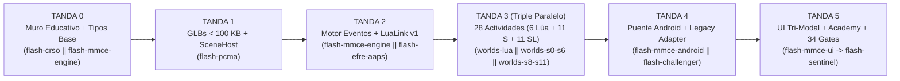

# Plan Operativo de Ejecución con Enjambre de Agentes (v2.0) · Integración AR Lúa Construye en Valeria+

Estado: **Versión 2.0 optimizada para ejecución autónoma por tandas en la rama `game`** · 30 de octubre de 2026.  
Ubicación canónica: `docs/PLAN-ENJAMBRE-AR-LUA-CONSTRUYE.md` (rama `game`).  
Documento compañero: [`docs/PLAN-INTEGRACION-AR-LUA-CONSTRUYE.md`](PLAN-INTEGRACION-AR-LUA-CONSTRUYE.md) y [`docs/PLAN-REFACTOR-STEAM.md`](PLAN-REFACTOR-STEAM.md).

---

## 0. Propósito y Mejoras Incorporadas en la Versión 2.0 del Plan de Enjambre

Este documento establece la **arquitectura de orquestación, partición de directorios, contratos atómicos de delegación y puertas de verificación (34 gates)** para que un enjambre de subagentes autónomos implemente el catálogo completo de **28 actividades de Realidad Aumentada** (**6 Solo Lúa** + **11 Sets Independientes** + **11 Sets con Lúa V5**) sin colisiones de código, sin regresión en los 30 gates existentes y con control estricto de tokens (**Regla R00**).

### 0.1 Correcciones Críticas respecto al Borrador v1.0 del Enjambre

| # | Debilidad en el Borrador v1.0 | Riesgo en Ejecución Real | Mejora Introducida en v2.0 |
| :- | :--- | :--- | :--- |
| **E1** | En la Tanda 2 v1.0 se pedía a un solo subagente modificar `ValeriaArActivity.kt` y crear 3 archivos Kotlin mientras la Tanda 3 tocaba `valeriaArBridge.ts`. | Los gates `check-ar-bridge-contract.js` y `verify-ar-clinical-math.js` inspeccionan **cruzadamente** los archivos `.kt` y `.ts`; ejecutarlos por separado rompe el gate intermedio. | Se introduce el patrón **`ArLegacyWorldAdapter` + Motor Declarativo TS (`src/steam/`)**: los 6 ejercicios nativos (`Ar1`–`Ar6`) permanecen intactos como detectores base y el sincronismo Kotlin $\leftrightarrow$ TS se verifica en una misma compuerta atómica. |
| **E2** | Un único subagente (`flash-mmce-rn`) debía escribir los 28 manifiestos bilingües/multilingües en una sola invocación. | Desbordamiento de ventana de salida o truncamiento al escribir 28 actividades $\times$ 4 idiomas de interfaz (`UiLang`: `es`, `en`, `ca`, `gl`) $\times$ 6 variedades (`Locale`). | **Partición horizontal en 3 subagentes paralelos en la Tanda 3** sobre archivos disjuntos: `flash-worlds-lua` (`L01`–`L06`), `flash-worlds-s0-s6` (`S0`–`S6` en modo `SET_SOLO` y `SET_WITH_LUA`) y `flash-worlds-s8-s11` (`S8`–`S11` en ambos modos). |
| **E3** | Faltaba la asignación explícita del rol **EFRE** (Firmware/Protocolo BLE) y la protección de hashes FNV-1a de **AAPS** (`valeriaVoiceCorpus.ts`). | Un obrero de UI podría alterar una cadena del corpus neuronal o inventar un opcode fuera de `firmware/lua/protocol.json` v1, rompiendo `check-voice-corpus-coverage.js` o `check-lua-mascot-mirror.js`. | Se incorpora el contrato **EFRE + AAPS** en la Tanda 2 que sella `LuaLink.ts` contra `protocol.json` v1 y prohíbe tocar `src/valeriaVoiceCorpus.ts` en todas las tandas. |
| **E4** | El borrador v1.0 referenciaba «SaMD Clase I» en el contrato de **CRSO**. | Contradice la decisión consolidada **R-A1** (`PLAN-REFACTOR-STEAM.md` §7): **Valeria+ es aplicación educativa (No SaMD)**. | El agente **CRSO** ejecuta como primer paso el gate `scripts/check-regulatory-vocabulary.js` que bloquea cualquier término clínico prohibido («terapia», «rehabilitación», «paciente», «prescripción», «desensibilización», «SOR», «Abrazo de oso»). |

---

## 1. Gobernanza del Enjambre y Reglas Inviolables (R0, R00, R000)

1. **Doctrina Jefe de Operaciones (`jefe-operaciones`)**:
   - El agente principal actúa **exclusivamente como Orquestador (`Orchestrator`)**: emite contratos autocontenidos, lanza subagentes con `invoke_subagent` (`Model: "flash"`, `TypeName: "self"` o `"research"`), audita los diffs devueltos y ejecuta/verifica el gate de salida de cada tanda.
   - **Prohibición de anidar subagentes (Profundidad Máxima = 1, Regla R00)**: Ningún subagente obrero, revisor o retador tiene permiso para invocar a otros subagentes (`EnableSubagentTools: false`).
2. **Partición Estricta de Escritura (Cero Conflictos de Merge)**:
   - Cuando dos o más subagentes corren en paralelo dentro de una misma tanda, **sus conjuntos de archivos de escritura (`WRITE_SET`) son matemáticamente disjuntos** ($W_i \cap W_j = \emptyset$).
   - Los archivos compartidos de barril o registro (`src/steam/worlds/index.ts`, `SceneHost.kt`, `package.json`) tienen un único propietario asignado por tanda.
3. **Subregla Diamante y Subregla de Oro (Regla R0)**:
   - Si Frank ordena detener el gasto de tokens, el Orquestador aborta inmediatamente toda invocación pendiente.
   - Al superar con `EXIT 0` el gate de una tanda, el Orquestador avanza automáticamente a la siguiente tanda planificada sin detenerse a pedir confirmación intermedia.

---

## 2. Topología del Enjambre y Matriz de Roles Canónicos

```mermaid
flowchart TB
    subgraph ORCH_LAYER["NIVEL 0 · DIRECCIÓN Y ARBITRAJE (Contexto Principal)"]
        ORCH["ORCHESTRATOR (Jefe de Operaciones)\nControla el grafo de 6 Tandas · Audita git diff · Aprueba cierres"]
    end

    subgraph WORKERS["NIVEL 1 · OBREROS ESPECIALISTAS (Model: flash · Profundidad = 1)"]
        CRSO["CRSO (flash-crso)\nMuro Educativo No-SaMD · Zero-PHI\ncheck-regulatory-vocabulary.js"]
        PCMA["PCMA (flash-pcma)\nModelos 3D GLB < 100 KB\nscripts/build-ar-models.js"]
        EFRE_AAPS["EFRE + AAPS (flash-efre-aaps)\nLuaLink protocol.json v1 (28 caras)\nTurnGate · Silencio 1000 ms · -20 dBFS"]
        MMCE_ENG["MMCE-Engine (flash-mmce-engine)\nsrc/steam/types.ts · validator.ts\nWorldRegistry · Stabilizer · Evaluator"]
        MMCE_W1["MMCE-Worlds-A (flash-worlds-lua)\nsrc/steam/worlds/luaSolo.ts\n(AR-L01 a AR-L06)"]
        MMCE_W2["MMCE-Worlds-B (flash-worlds-s0-s6)\nsrc/steam/worlds/s0..s6.ts\n(Modos SET_SOLO y SET_WITH_LUA)"]
        MMCE_W3["MMCE-Worlds-C (flash-worlds-s8-s11)\nsrc/steam/worlds/s8..s11.ts\n(Oficios: SET_SOLO y SET_WITH_LUA)"]
        MMCE_KT["MMCE-Android (flash-mmce-android)\nSceneHost.kt · ArLegacyWorldAdapter.ts\nSoporte RevealLayer en Filament"]
        MMCE_UI["MMCE-UI (flash-mmce-ui)\nValeriaSteamWorldScreen.tsx\nValeriaArLauncherScreen.tsx · Academy"]
    end

    subgraph AUDITORS["NIVEL 1B · RETADORES Y AUDITORES DE VICTORIA (Model: flash)"]
        CHALL["CHALLENGER (flash-challenger)\nObservationReplay adversarial\nCono ±12° · Oclusión · Caída BLE"]
        SENTINEL["SENTINEL / VICTORY AUDITOR (flash-sentinel)\nEjecución empírica de los 34 Gates\nActualización de STATUS.md"]
    end

    ORCH --> CRSO & PCMA & EFRE_AAPS & MMCE_ENG
    ORCH --> MMCE_W1 & MMCE_W2 & MMCE_W3
    ORCH --> MMCE_KT & MMCE_UI
    ORCH --> CHALL & SENTINEL
```



### 2.1 Matriz de Permisos y Prohibiciones por Subagente

| Identificador del Subagente | Rol Canónico | `WRITE_SET` (Archivos que PUEDE crear/editar) | `FORBIDDEN_SET` (Veto Incondicional si los toca) |
| :--- | :---: | :--- | :--- |
| **`flash-crso`** | **CRSO** | `scripts/check-regulatory-vocabulary.js`, `src/i18n/strings.*.ts`, `src/ValeriaSensory/sensoryCatalog.ts`, `src/ValeriaAcademy/*.ts`, `site/*.html` | `src/valeriaVoiceCorpus.ts`, `assets/voice/**`, `firmware/lua/protocol.json` |
| **`flash-pcma`** | **PCMA** | `scripts/build-ar-models.js`, `assets/models/*.glb`, `assets/models/README.md`, `scripts/check-ar-reveal-layers.js` | Cualquier archivo `.scad` (OpenSCAD prohibido), archivos `.tsx` o `.kt` fuera de `SceneHost.kt` |
| **`flash-mmce-engine`** | **MMCE** | `src/steam/types.ts`, `src/steam/validator.ts`, `src/steam/engine/WorldRegistry.ts`, `src/steam/engine/EventStabilizer.ts`, `src/steam/engine/ChallengeEvaluator.ts`, `src/steam/engine/ObservationReplay.ts` | `android-native/**`, `src/valeriaVoiceCorpus.ts` |
| **`flash-efre-aaps`** | **EFRE + AAPS** | `src/steam/engine/LuaLink.ts`, `src/steam/engine/TurnGate.ts`, `src/steam/engine/ReactionSequencer.ts`, `src/steam/engine/WordPrompter.ts` | `firmware/lua/protocol.json` (congelado en v1), `assets/sensory/*.wav`, `assets/voice/*.m4a` |
| **`flash-worlds-lua`** | **MMCE** | `src/steam/worlds/luaSolo.ts` (`AR-L01` a `AR-L06`) | `src/steam/worlds/s*.ts`, `src/steam/engine/**` |
| **`flash-worlds-s0-s6`** | **MMCE** | `src/steam/worlds/s0_kit.ts` a `src/steam/worlds/s6_jardin.ts` (`AR-S00`–`S06` y `AR-SL00`–`SL06`) | `src/steam/worlds/luaSolo.ts`, `src/steam/worlds/s8*.ts`–`s11*.ts` |
| **`flash-worlds-s8-s11`** | **MMCE** | `src/steam/worlds/s8_policia.ts`, `s9_bomberos.ts`, `s10_hospital.ts`, `s11_trenes.ts`, `src/steam/worlds/index.ts`, `scripts/check-steam-manifests.js`, `scripts/check-lua-tri-modal-coverage.js` | `src/steam/worlds/s0*.ts`–`s6*.ts` |
| **`flash-mmce-android`** | **MMCE** | `android-native/valeria-ar/src/main/java/eu/futureforkids/valeria/ar/scene/SceneHost.kt`, `src/steam/engine/Detectors.ts`, `src/steam/adapters/ArLegacyWorldAdapter.ts`, `src/valeriaArBridge.ts` | `Ar1Orofacial.kt` a `Ar6BuddyMimicry.kt` (no alterar la matemática interna auditada por `verify-ar-clinical-math.js`) |
| **`flash-mmce-ui`** | **MMCE** | `src/ValeriaSteamWorldScreen.tsx`, `src/ValeriaArLauncherScreen.tsx`, `src/ValeriaAcademy/steamCapsules.ts`, `src/i18n/strings.*.ts` | `ValeriaFichaRegistroScreen.tsx` (`CAMPOS_FICHA` congelado por `check-data-safety-declaration.js`) |
| **`flash-challenger`** | **Challenger** | `scripts/stress-test-steam-ar.js` (y pruebas en `ObservationReplay.ts`) | Archivos de producción en `src/` o `android-native/` |
| **`flash-sentinel`** | **Auditor** | `STATUS.md`, `package.json` (solo scripts `check:*`) | Código funcional sin orden expresa del Orquestador |

---

## 3. Plan de Ejecución en 6 Tandas (Olas Secuenciales con Paralelismo Interno)



---

### TANDA 0 · Muro Regulatorio Educativo (No SaMD) y Contratos de Tipos Base

- **Subagentes en paralelo**: `flash-crso` $\parallel$ `flash-mmce-engine`
- **Presupuesto estimado**: $\le 2$ invocaciones Flash.

#### Contrato `T0-A` para `flash-crso`:
```markdown
ROL: Clinical Regulatory & Safety Officer (CRSO)
OBJETIVO:
1. Crear `scripts/check-regulatory-vocabulary.js` que escanee `src/i18n/`, `src/ValeriaSensory/`, `src/ValeriaAcademy/`, campos `read:` de `src/valeriaExercise*.ts` y `site/*.html` prohibiendo los términos de `docs/PLAN-REFACTOR-STEAM.md` §7.2 (tratamiento, terapia, rehabilitación, prescripción, paciente, desensibilización, SOR, PRT, TCC, cierre velar, estresor, Abrazo de oso / Abraçada d'ós).
2. Reemplazar en esos archivos los términos detectados por sus equivalentes educativos aprobados, y cambiar en `sensoryCatalog.ts` la agencia infantil por «A señal del menor (pulsa el adulto)».
PROHIBIDO TOCAR: `src/valeriaVoiceCorpus.ts`, `assets/voice/**`, claves de `AsyncStorage`.
COMANDO DE VERIFICACIÓN:
`node scripts/check-regulatory-vocabulary.js && node scripts/check-voice-corpus-coverage.js && node scripts/check-ui-strings.js` -> EXIT 0.
```

#### Contrato `T0-B` para `flash-mmce-engine`:
```markdown
ROL: Multiplatform Mobile Core Engineer — Arquitecto de Tipos STEAM
OBJETIVO:
1. Crear `src/steam/types.ts` implementando todas las interfaces de `docs/PLAN-REFACTOR-STEAM.md` §2.3 y `docs/PLAN-INTEGRACION-AR-LUA-CONSTRUYE.md` §6.1:
   - `SteamWorldId` ('LUA' | 'S0'..'S6' | 'S8'..'S11')
   - `SteamArMode` ('LUA_SOLO' | 'SET_SOLO' | 'SET_WITH_LUA')
   - `SteamActivityId` (las 28 claves: AR-L01..06, AR-S00..11, AR-SL00..11)
   - `AdultText` (es, en, ca, gl) y `ChildSpeechMap` (es, gl, eu, es-DO, en-US, ca)
   - `TripartiteCycle` (observa con mandatorySilenceSec: 5, experimenta con hints N1/N2, construye)
   - `WorldEventSpec`, `WorldChallengeSpec`, `WorldPieceSpec`, `WorldManifest`.
2. Crear `src/steam/validator.ts` que valide en tiempo de carga y en CI que toda actividad incluya `'adult_tap'` en `methods`, que en `turn === 'verbal'` o `isErrorOrBlockedState === true` tanto `light` como `haptic` sean `'APAGADO'`, y que en `SET_SOLO` no se exija enlace BLE obligatorio.
PROHIBIDO TOCAR: Archivos fuera de `src/steam/`.
COMANDO DE VERIFICACIÓN: `npx tsc --noEmit` -> EXIT 0.
```

---

### TANDA 1 · Generación Procedural de Modelos 3D GLB ($< 100\text{ KB}$) y Contrato `ArModel`

- **Subagente asignado**: `flash-pcma`
- **Presupuesto estimado**: 1 invocación Flash.

#### Contrato `T1-A` para `flash-pcma`:
```markdown
ROL: Procedural CAD & 3D Assets Specialist (PCMA)
OBJETIVO:
1. Extender `scripts/build-ar-models.js` (que hoy genera `coche.glb`, `perro.glb`, `manzana.glb`, `pelota.glb`, `zapato.glb`, `lua.glb`, `pez.glb` en glTF 2.0 binario puro sin dependencias externas) para generar también los 8 nuevos modelos de revelación en `assets/models/`:
   - `lua_v5_body.glb` (animación: `"celebrate"`)
   - `set_camino.glb` (animación: `"flow"`)
   - `set_sonido.glb` (animación: `"resonate"`)
   - `set_rampas.glb` (animación: `"roll"`)
   - `set_soplo.glb` (animación: `"spin_rotor"`)
   - `set_puente.glb` (animación: `"balance"`)
   - `set_jardin.glb` (animación: `"bloom"`)
   - `set_oficios.glb` (animación: `"celebrate"`)
2. Registrar las 8 entradas en el enum `ArModel` de `android-native/valeria-ar/src/main/java/eu/futureforkids/valeria/ar/scene/SceneHost.kt` conservando intactas las 7 entradas originales.
3. Crear `scripts/check-ar-reveal-layers.js` que verifique que cada uno de los 15 GLB pesa estrictamente `< 100 KB` (102400 bytes) y expone su animación exacta.
PROHIBIDO: Usar OpenSCAD o superar 100 KB por archivo `.glb`.
COMANDO DE VERIFICACIÓN:
`node scripts/build-ar-models.js && node scripts/check-ar-models.js && node scripts/check-ar-reveal-layers.js` -> EXIT 0.
```

---

### TANDA 2 · Motor Declarativo de Eventos, `LuaLink` (`protocol.json` v1) y `ObservationReplay`

- **Subagentes en paralelo**: `flash-mmce-engine` $\parallel$ `flash-efre-aaps`
- **Presupuesto estimado**: 2 invocaciones Flash.

#### Contrato `T2-A` para `flash-mmce-engine`:
```markdown
ROL: Multiplatform Mobile Core Engineer — Motor de Eventos STEAM
OBJETIVO:
Implementar en `src/steam/engine/`:
1. `WorldRegistry.ts`: Registro indexado por `SteamWorldId`, `SteamArMode` y `SteamActivityId`.
2. `EventStabilizer.ts`: Ventana deslizante que confirma un evento visual tras 10 fotogramas estables (~330 ms a 30 fps) e inmediatamente (1 frame) cuando `method === 'adult_tap'`.
3. `ChallengeEvaluator.ts`: Evaluadores deterministas:
   - Continuidad de grafo y giros 90° para `S1` y `S11`.
   - Ángulo de brazo percutor y secuencia rítmica para `S2`.
   - Comparación relativa de tiempo de bajada ($t_n < t_{n-1}$) para `S3` y `S9`.
   - Equilibrio estático de momentos ($\sum m_i d_i = \sum m_j d_j$, tolerancia angular $|\theta| \le 1.5^\circ$) para `S5`.
   - Secuencia causal de estados para `S0`, `S4`, `S6`, `S8` y `S10`.
4. `ObservationReplay.ts`: Reproductor determinista de trazas sintéticas (positiva, negativa y con oclusión parcial) 100 % libre de datos de niños.
COMANDO DE VERIFICACIÓN: `npx tsc --noEmit` -> EXIT 0.
```

#### Contrato `T2-B` para `flash-efre-aaps`:
```markdown
ROL: Embedded Firmware & Audio Pipeline Specialist (EFRE + AAPS)
OBJETIVO:
Implementar en `src/steam/engine/`:
1. `LuaLink.ts`: Tabla de Traducción Semántica 1:1 desde `LuaSemanticExpression` hacia los opcodes reales de `firmware/lua/protocol.json` v1 (`IDLE 0x04`, `PHASE 0x01`, `VERDICT 0x02`, `CELEBRATE 0x03`, `AFFECT 0x06`, `PICTO 0x07`, `AWARD 0x08`, `MOOD 0x0B` [0..4], `ACCESSORY 0x0C`, `RELAX 0x0D`), mapeando a las 28 caras oficiales (#0 a #27).
   - En modo `'SET_SOLO'`, `LuaLink` no exige conexión BLE y solo actualiza el estado de la capa de revelación.
   - En modos `'LUA_SOLO'` y `'SET_WITH_LUA'`, si Lúa V5 está conectada por BLE emite el paquete en `< 300 ms`; si no está conectada, espeja exactamente la misma cara en el widget `CatPixel` / `lua.glb` de la tableta.
2. `TurnGate.ts`: Fuerza `light = 'APAGADO'` y `haptic = 'APAGADO'` siempre que `turn === 'verbal'`, `isErrorOrBlockedState === true` o edad `< 3` años (`I1`–`I3`).
3. `ReactionSequencer.ts`: Garantiza el orden estricto: fenómeno físico -> espera `pauseBeforeReactionMs` (1000 ms obligatorios en Set 2 para no pisar el sonido real del resonador) -> reacción visual de Lúa (< 300 ms) -> `WordPrompter.ts`.
PROHIBIDO TOCAR: `firmware/lua/protocol.json`, `src/valeriaVoiceCorpus.ts`.
COMANDO DE VERIFICACIÓN:
`node scripts/build-lua-protocol.js --check && node scripts/check-lua-mascot-mirror.js && npx tsc --noEmit` -> EXIT 0.
```

---

### TANDA 3 · Manifiestos Completos de las 28 Actividades (Triple Ejecución Paralela)

- **Subagentes en paralelo**: `flash-worlds-lua` $\parallel$ `flash-worlds-s0-s6` $\parallel$ `flash-worlds-s8-s11`
- **Presupuesto estimado**: 3 invocaciones Flash paralelas sobre archivos disjuntos.

#### Contrato `T3-A` para `flash-worlds-lua`:
```markdown
ROL: Especialista Curricular y de Manifiestos — Catálogo 1: Solo Lúa (`LUA_SOLO`)
ARCHIVO A CREAR: `src/steam/worlds/luaSolo.ts`
OBJETIVO:
Definir el manifiesto completo de las **6 actividades específicas Solo para Lúa V5** (`AR-L01` a `AR-L06`) conforme a `docs/PLAN-INTEGRACION-AR-LUA-CONSTRUYE.md` §3:
- `AR-L01`: El Espejo de Gestos de Lúa (detector `face` + `adult_tap`, micrófono apagado, `Ar1Orofacial`).
- `AR-L02`: ¿Hacia Dónde Mira Lúa? (detector `marker` en `K-LOMO-G` + `adult_tap`, vector de rumbo).
- `AR-L03`: La Merienda del Pez Dorado (detector `occlusion`/`marker` acercando bloque físico a Lúa + `adult_tap`, sin que el niño toque la pantalla).
- `AR-L04`: El Despertar Sereno de Lúa (detector `face` cono ±12° + `adult_tap`, `RELAX` #18 -> `AFFECT 4` #14).
- `AR-L05`: La Caricia y el Ronroneo (detector `hand` sobre lomo + `adult_tap`, `MOOD 2: PURRING` #21 + `RONRONEO` a -20 dBFS en ≥ 3 años).
- `AR-L06`: ¿Dónde Cantó el Pajarito? (detector `face` giro cefálico `Ar2Vra` + `adult_tap`).
Cada actividad debe incluir textos completos en los 4 idiomas de `AdultText` (`es`, `en`, `ca`, `gl`), Ciclo Didáctico Tripartito (`observa` con 5 s de silencio, `experimenta` con pistas N1/N2, `construye`), comando TPR en inglés y trazas de prueba para `ObservationReplay`.
COMANDO DE VERIFICACIÓN: `npx tsc --noEmit` -> EXIT 0.
```

#### Contrato `T3-B` para `flash-worlds-s0-s6`:
```markdown
ROL: Especialista Curricular y de Manifiestos — Mundos Fundacionales `S0` a `S6`
ARCHIVOS A CREAR:
- `src/steam/worlds/s0_kit.ts`
- `src/steam/worlds/s1_camino.ts`
- `src/steam/worlds/s2_sonido.ts`
- `src/steam/worlds/s3_rampas.ts`
- `src/steam/worlds/s4_soplo.ts`
- `src/steam/worlds/s5_puente.ts`
- `src/steam/worlds/s6_jardin.ts`
OBJETIVO:
Implementar los 7 manifiestos fundacionales de `Construye con Lúa`, exponiendo en cada uno:
1. Su actividad en **Modalidad II · Set Independiente (`SET_SOLO`)**: `AR-S00` a `AR-S06` (centrada en las piezas del BOM real de `Lua construye/sets/`, su fenómeno físico y su `RevealLayer` GLB `< 100 KB`).
2. Su actividad en **Modalidad III · Set Integrado con Lúa V5 (`SET_WITH_LUA`)**: `AR-SL00` a `AR-SL06` (con Lúa en el zócalo `K-ZOCALO-G` o deslizándose con el patín de 2 pivotes `K-PATIN-G`, sus eventos `S<n>.*` y reacciones `LuaLink` hacia las 28 caras de `protocol.json` v1).
3. Textos en los 4 idiomas `AdultText` (`es`, `en`, `ca`, `gl`), Ciclo Tripartito (`observa` 5 s, `experimenta` N1/N2, `construye`), `tabletStandSpec`, enlaces a `AventurasLua` y prácticas de mesa, y casos de prueba para `ObservationReplay`.
COMANDO DE VERIFICACIÓN: `npx tsc --noEmit` -> EXIT 0.
```

#### Contrato `T3-C` para `flash-worlds-s8-s11`:
```markdown
ROL: Especialista Curricular y de Manifiestos — Mundos de Comunidad y Oficios `S8` a `S11` + Gates de Manifiestos
ARCHIVOS A CREAR:
- `src/steam/worlds/s8_policia.ts`
- `src/steam/worlds/s9_bomberos.ts`
- `src/steam/worlds/s10_hospital.ts`
- `src/steam/worlds/s11_trenes.ts`
- `src/steam/worlds/index.ts` (barril que registra `luaSolo` + los 11 sets `S0`..`S6` y `S8`..`S11`)
- `scripts/check-steam-manifests.js`
- `scripts/check-lua-tri-modal-coverage.js`
OBJETIVO:
1. Implementar los 4 manifiestos de oficios y comunidad (`S8` Policía y Tráfico, `S9` Parque de Bomberos, `S10` Hospital Infantil y Calma, `S11` Red de Trenes y Ferrocarril) tanto en modo independiente (`AR-S08` a `AR-S11`) como en modo integrado con Lúa V5 (`AR-SL08` a `AR-SL11`).
2. Crear `scripts/check-steam-manifests.js` y `scripts/check-lua-tri-modal-coverage.js` para verificar automáticamente:
   - Que existen exactamente las **28 actividades** (6 `LUA_SOLO` + 11 `SET_SOLO` + 11 `SET_WITH_LUA`).
   - Que todas pasan `validator.ts` y `ObservationReplay` (casos positivo, negativo y oclusión) en `< 300 ms`.
   - Que todas tienen cobertura 100 % en `es`, `en`, `ca` y `gl` sin ningún término prohibido por `check-regulatory-vocabulary.js`.
COMANDO DE VERIFICACIÓN:
`node scripts/check-steam-manifests.js && node scripts/check-lua-tri-modal-coverage.js` -> EXIT 0.
```

---

### TANDA 4 · Puente Nativo Android, `ArLegacyWorldAdapter` y Pruebas Adversariales

- **Subagentes en paralelo**: `flash-mmce-android` $\parallel$ `flash-challenger`
- **Presupuesto estimado**: 2 invocaciones Flash.

#### Contrato `T4-A` para `flash-mmce-android`:
```markdown
ROL: Multiplatform Mobile Core Engineer — Puente AR Nativo y Adaptadores
OBJETIVO:
1. Crear `src/steam/engine/Detectors.ts` y `src/steam/adapters/ArLegacyWorldAdapter.ts` que conecten las señales de `valeriaArBridge.ts` (y los ejercicios nativos `ar1`–`ar6`) con las 28 actividades del motor STEAM, sin romper una sola línea de los contratos exigidos por `scripts/check-ar-bridge-contract.js`, `scripts/verify-ar-clinical-math.js` y `scripts/check-ar-concurrency.js`.
2. Añadir en `src/valeriaArBridge.ts` el helper tipado `resolveNativeExerciseForSteamActivity(activityId: SteamActivityId): ArExerciseId` para que cualquier lanzamiento de cámara desde una actividad STEAM delegue de forma segura en el host nativo o en el modo de mesa con `adult_tap` y `RevealLayer`.
PROHIBIDO: Borrar o renombrar `Ar1Orofacial.kt`..`Ar6BuddyMimicry.kt` ni alterar las constantes matemáticas auditadas por `verify-ar-clinical-math.js`.
COMANDO DE VERIFICACIÓN:
`node scripts/check-ar-bridge-contract.js && node scripts/verify-ar-clinical-math.js && node scripts/check-ar-concurrency.js && node scripts/stress-test-ar-adversarial.js` -> EXIT 0.
```

#### Contrato `T4-B` para `flash-challenger`:
```markdown
ROL: Challenger — Ingeniero de Pruebas Adversariales y Estrés
ARCHIVO A CREAR: `scripts/stress-test-steam-ar.js`
OBJETIVO:
Escribir una suite adversarial en Node.js que someta las 28 actividades (`AR-L01..06`, `AR-S00..11`, `AR-SL00..11`) a 1.000 ciclos de simulación comprobando:
1. Oclusión intermitente (9 frames válidos seguidos de 1 frame perdido: `EventStabilizer` NO debe disparar falso positivo).
2. Conmutación rápida a `turn === 'verbal'`: `TurnGate` debe cortar `light` y `haptic` en el acto (0 fugas).
3. Desconexión abrupta de BLE a mitad de `AR-SL01` o `AR-SL10`: degradación elegante al espejo en pantalla sin excepciones no capturadas.
4. Cumplimiento estricto del silencio de `1000 ms` en `AR-S02` y `AR-SL02` antes de emitir reacción o voz.
COMANDO DE VERIFICACIÓN: `node scripts/stress-test-steam-ar.js` -> EXIT 0.
```

---

### TANDA 5 · Interfaz de Usuario Tri-Modal, Cápsulas de Academy y Auditoría Final de 34 Gates

- **Subagentes secuenciales**: `flash-mmce-ui` $\rightarrow$ `flash-sentinel`
- **Presupuesto estimado**: 2 invocaciones Flash.

#### Contrato `T5-A` para `flash-mmce-ui`:
```markdown
ROL: Multiplatform Mobile Core Engineer — UI React Native y Academy
OBJETIVO:
1. Crear `src/ValeriaSteamWorldScreen.tsx` e integrarlo en `src/ValeriaArLauncherScreen.tsx` con un selector claro de **3 pestañas para la persona adulta**:
   - Pestaña 1: **«Solo con Lúa V5»** (6 actividades `AR-L01` a `AR-L06`).
   - Pestaña 2: **«11 Sets Independientes (Mundos STEAM)»** (11 actividades `AR-S00` a `AR-S11` con activador de `RevealLayer`).
   - Pestaña 3: **«11 Sets + Lúa V5 Conectada»** (11 actividades `AR-SL00` a `AR-SL11` con estado BLE en vivo y botón universal `adult_tap`).
2. Mostrar en pantalla la tarjeta del **Ciclo Didáctico Tripartito** (*1. Observa [con temporizador visual de 5 s de silencio] -> 2. Experimenta [desplegable de Pista N1 y Pista N2] -> 3. Construye*), las etiquetas de vocabulario espacial *BrickSmart* y el comando TPR en inglés.
3. Añadir en `src/ValeriaAcademy/` las cápsulas de mediación para los mundos (`STEAM-LUA`, `STEAM-S0` a `STEAM-S6` y `STEAM-S8` a `STEAM-S11`) en los 4 idiomas `UiLang` (`es`, `en`, `ca`, `gl`).
PROHIBIDO: Literales de texto quemados fuera de i18n; controles pensados para que los pulse el menor.
COMANDO DE VERIFICACIÓN:
`node scripts/check-ui-strings.js && node scripts/check-ui-lang-fallback.js && npx tsc --noEmit` -> EXIT 0.
```

#### Contrato `T5-B` para `flash-sentinel`:
```markdown
ROL: Sentinel / Victory Auditor — Guardián de los 34 Gates y Documentación
OBJETIVO:
1. Registrar en `package.json` los 4 nuevos scripts de verificación (`check:regulatory-vocab`, `check:steam-manifests`, `check:lua-tri-modal`, `check:ar-reveal-layers`).
2. Ejecutar la batería completa de **34 gates** del repositorio y verificar empíricamente que todos devuelven `EXIT 0`.
3. Actualizar `STATUS.md` con la tabla de resultados empíricos (comando ejecutado + código de salida + fecha).
COMANDO DE VERIFICACIÓN: Batería completa de 34 gates -> 34/34 EXIT 0.
```

---

## 4. Batería Completa de 34 Gates de Verificación Empírica (Criterio de «Hecho»)

El Orquestador solo dará por finalizado el trabajo del enjambre cuando el comando unificado de validación arroje **34/34 gates en verde (`EXIT 0`)**:

| # | Script / Gate en `Valeria/` | Qué Verifica Empíricamente |
| :- | :--- | :--- |
| 1–30 | **Los 30 gates actuales de `.github/workflows/android.yml`** | Modelos AR, contrato puente AR, matemática clínica AR, concurrencia AR, estrés adversarial AR, protocolo BLE Lúa, espejo de 28 caras de Lúa, corpus neuronal FNV-1a, activos sensoriales a $-20\text{ dBFS}$, localización `UiLang`/`Locale`, declaración Data Safety Zero-PHI, `tsc --noEmit`, tests unitarios. |
| **31** | `node scripts/check-regulatory-vocabulary.js` | Cero términos médicos/terapéuticos prohibidos en UI, Academy, `read:` y `site/`; cero menciones al oso retirado o a que el menor toque la pantalla. |
| **32** | `node scripts/check-steam-manifests.js` | Validez estructural y semántica de los manifiestos (`LUA`, `S0`–`S6`, `S8`–`S11`), presencia de `adult_tap`, `TurnGate` y Ciclo Tripartito completo con 5 s de silencio. |
| **33** | `node scripts/check-lua-tri-modal-coverage.js` | Existencia y paridad multilingüe (`es`, `en`, `ca`, `gl`) de las **28 actividades** exactas: **6 Solo Lúa** + **11 Sets Independientes** + **11 Sets con Lúa V5**, todas mapeadas a caras válidas (#0–#27) de `protocol.json` v1. |
| **34** | `node scripts/check-ar-reveal-layers.js` (+ `stress-test-steam-ar.js`) | Presupuesto $< 100\text{ KB}$ en los 15 archivos `.glb` de `assets/models/` y superación de los 1.000 ciclos adversariales de `ObservationReplay` sin fallos ni fugas. |
