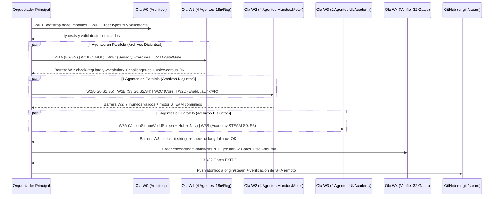

# Plan de Orquestación Autónoma (v2.0) · Enjambre de Agentes para Refactorización STEAM

Estado: **Versión 2.0 auditada y libre de colisiones de archivos** · octubre 2026. Ubicación en repositorio: `docs/PLAN-ENJAMBRE-STEAM.md` (rama `steam`).

---

## 0. Auditoría Crítica del Plan de Enjambre v1 y Mejoras Incorporadas en v2.0

Al auditar la versión inicial del plan de orquestación frente al entorno de ejecución real de Valeria+ y a las reglas de gobernanza (**R0**, **R00**, **R000** y el skill `jefe-operaciones`), se detectaron y corrigieron **5 defectos operativos críticos** que habrían provocado fallos o bloqueos durante la ejecución autónoma:

| # | Defecto en el Plan de Enjambre v1 | Causa Raíz / Riesgo Real | Corrección Arquitectónica en este Plan v2.0 |
| :- | :--- | :--- | :--- |
| **E1** | **Condición de carrera en Tanda 1:** `Agent-R1A-Types` (`types.ts`, `validator.ts`) se lanzaba en paralelo al mismo tiempo que `Agent-R1B` y `Agent-R1C` (`set0..set6.ts`). | Si `R1B` y `R1C` escriben manifiestos antes de que exista `src/steam/types.ts`, inventan firmas incompatibles y rompen `tsc --noEmit`. | **Barrera W0 previa:** `Agent-W0-Architect` crea y compila `src/steam/types.ts` y `src/steam/validator.ts` **antes** de abrir la Ola W2 de construcción paralela de mundos y motor. |
| **E2** | **Sobrecarga de contexto en `Agent-R0-Regulator`:** Un único agente Flash recibía 18 archivos que suman **> 650 KB** (los 4 `strings.*.ts` de > 415 KB + 6 `valeriaExercise*.ts` + 2 `academyContent*.ts` de 130 KB + `sensoryCatalog.ts` + 4 `site/*.html`). | Un solo subagente Flash editando 650 KB agota su ventana de salida o rompe la paridad 1:1 de `test-challenger-final-ca-integration.js` (que exige > 1.000 claves y > 200 funciones idénticas entre `ES`, `EN`, `CA` y `GL`). | **Partición en 4 agentes paralelos sin solapamiento (Ola W1):** `W1A` (`ES`+`EN`), `W1B` (`CA`+`GL`), `W1C` (`sensoryCatalog` + `valeriaExercise*`), `W1D` (`site/*` + gate regulatorio), con contrato de claves `t.steam` congelado en W0. |
| **E3** | **Fallo predecible de entorno (`MODULE_NOT_FOUND: typescript`):** En `Valeria/` no existía carpeta `node_modules` local, haciendo que `node scripts/check-ui-strings.js` fallara y `npx tsc` intentara salir a internet (error `E403` en sandbox). | Sin resolver `typescript` y `.bin/tsc` localmente antes de lanzar el enjambre, **todos los subagentes habrían fallado al verificar sus propios gates**. | **Paso Pre-Flight `W0.1`:** Enlace local en `Valeria/node_modules` hacia los binarios ya instalados en el workspace (`Paginas web/node_modules/typescript`), permitiendo que los **32 gates y `tsc` corran 100 % offline dentro del sandbox**. |
| **E4** | **Aserciones sensibles en `test-challenger-final-ca-integration.js`:** La línea 450 de dicho gate comprueba `tCa.settings.uiLangAutoHint.includes('exercicis') || tCa.settings.uiLangAutoHint.includes('teràpia')`, y la línea 592 comprueba `'ficha.pathologyLabel': 'Hipoacusia con Implante Coclear'`. | Una purga ciega que cambiara `'exercicis'` en catalán o la firma de `ficha.pathologyLabel` rompería el gate de integración catalana. | Los contratos de `W1A` y `W1B` incluyen la lista exacta de **invariantes de test** que deben preservarse (`'exercicis'` en `uiLangAutoHint` catalán y `'exercicios'` en gallego). |
| **E5** | **Diagrama `gantt` no soportado y falta de Ola de Despliegue en Nube:** El bloque `gantt` no está soportado por el renderizador de artefactos y faltaba la ola final de push a `origin/steam`. | Incumple las directrices de formato de artefactos y el mandato de ejecución real en la nube (`ejecucion-real.md`). | Se reemplaza por diagramas `flowchart LR` y `sequenceDiagram` válidos, y se añade la **Ola W5** de publicación verificada en `origin/steam` vía `github-mcp-server`. |

---

## 1. Arquitectura del Enjambre: 6 Olas con Barreras Estrictas (W0 a W5)

Principio rector (**Invariante de Disyunción de Archivos**): **En una misma ola paralela, dos subagentes jamás tienen permiso de escritura sobre el mismo archivo.** Toda dependencia entre archivos se resuelve mediante barreras de sincronización entre olas.

```mermaid
flowchart LR
    subgraph W0["OLA W0 · Bootstrap & Contrato Base"]
        W0_1["W0.1 Pre-Flight\n(node_modules local offline)"]
        W0_2["Agent-W0-Architect\n(src/steam/types.ts + validator.ts)"]
        W0_1 --> W0_2
    end

    subgraph W1["OLA W1 · Purga Regulatoria + i18n (4 Agentes Paralelos)"]
        W1A["Agent-W1A-I18n-EsEn\n(strings.es.ts, strings.en.ts)"]
        W1B["Agent-W1B-I18n-CaGl\n(strings.ca.ts, strings.gl.ts)"]
        W1C["Agent-W1C-Adult-Sensory\n(sensoryCatalog + valeriaExercise*)"]
        W1D["Agent-W1D-Site-RegGate\n(site/*.html + check-regulatory-vocabulary.js)"]
    end

    subgraph W2["OLA W2 · Mundos S0–S6 & Motor Reactivo (4 Agentes Paralelos)"]
        W2A["Agent-W2A-Worlds-A\n(set0, set1, set5)"]
        W2B["Agent-W2B-Worlds-B\n(set3, set6, set2, set4, index)"]
        W2C["Agent-W2C-Engine-Core\n(WorldRegistry, Stabilizer, TurnGate, Replay)"]
        W2D["Agent-W2D-Engine-Eval\n(Evaluator, Sequencer, LuaLink, Detectors, LegacyAR)"]
    end

    subgraph W3["OLA W3 · UI 3 Capas & Academy (2 Agentes Paralelos)"]
        W3A["Agent-W3A-UI-Nav\n(ValeriaSteamWorldScreen, HubV11, AppNavigator)"]
        W3B["Agent-W3B-Academy\n(academyContent.ts, academyContent.en.ts)"]
    end

    subgraph W4["OLA W4 · Gate STEAM & Suite 32 Gates"]
        W4A["Agent-W4-Verifier\n(check-steam-manifests.js + 32 Gates + tsc)"]
    end

    subgraph W5["OLA W5 · Despliegue en Nube"]
        W5A["Orquestador · Push & Verify\n(origin/steam SHA + git status)"]
    end

    W0 --> W1 --> W2 --> W3 --> W4 --> W5
```



---

## 2. Catálogo Completo de Agentes, Ámbitos y Presupuesto de Control (R00)

| Ola | ID del Agente | Modelo | Archivos con Permiso de Escritura (Exclusivo) | Archivos Prohibidos (Veto) | Gate de Salida de la Unidad |
| :- | :--- | :- | :--- | :--- | :--- |
| **W0** | `Agent-W0-Architect` | `flash` | `src/steam/types.ts`, `src/steam/validator.ts` | Todo fuera de `src/steam/` | Compilación limpia con `tsc` |
| **W1** | `Agent-W1A-I18n-EsEn` | `flash` | `src/i18n/strings.es.ts`, `src/i18n/strings.en.ts` | `strings.ca.ts`, `strings.gl.ts`, `valeriaVoiceCorpus.ts` | Paridad de claves `ES` $\leftrightarrow$ `EN` |
| **W1** | `Agent-W1B-I18n-CaGl` | `flash` | `src/i18n/strings.ca.ts`, `src/i18n/strings.gl.ts` | `strings.es.ts`, `strings.en.ts`, `valeriaVoiceCorpus.ts` | `node scripts/test-challenger-final-ca-integration.js` |
| **W1** | `Agent-W1C-Adult-Sensory` | `flash` | `src/ValeriaSensory/sensoryCatalog.ts`, `src/valeriaExerciseBank.ts`, `src/valeriaExercise{Gl,Eu,Ca,En,EsDO}.ts` | Campos locutados al niño (`prompt`, `tts`, `target`, `valeriaVoiceCorpus.ts`) | `node scripts/check-adult-fields.js` y `node scripts/check-voice-corpus-coverage.js` |
| **W1** | `Agent-W1D-Site-RegGate` | `flash` | `site/index.html`, `site/privacidad.html`, `site/privacy.html`, `site/eliminacion-de-datos.html`, `README.md`, `scripts/check-regulatory-vocabulary.js` | Versión `3.0.0` y tabla de campos de ficha en `site/privacidad.html` (`D6` de `check-data-safety-declaration.js`) | `node scripts/check-legal-urls.js --offline` y `node scripts/check-data-safety-declaration.js` |
| **W2** | `Agent-W2A-Worlds-A` | `flash` | `src/steam/worlds/set0_kit_lua.ts`, `src/steam/worlds/set1_path.ts`, `src/steam/worlds/set5_balance.ts` | `src/steam/types.ts`, `src/steam/validator.ts` | `validateWorldManifest` = `valid: true` en `S0`, `S1`, `S5` |
| **W2** | `Agent-W2B-Worlds-B` | `flash` | `src/steam/worlds/set3_motion.ts`, `src/steam/worlds/set6_garden.ts`, `src/steam/worlds/set2_sound.ts`, `src/steam/worlds/set4_breath.ts`, `src/steam/worlds/index.ts` | `src/steam/types.ts`, `src/steam/validator.ts` | `validateWorldManifest` = `valid: true` en `S3`, `S6`, `S2`, `S4` |
| **W2** | `Agent-W2C-Engine-Core` | `flash` | `src/steam/engine/WorldRegistry.ts`, `src/steam/engine/EventStabilizer.ts`, `src/steam/engine/TurnGate.ts`, `src/steam/engine/ObservationReplay.ts` | Módulos fuera de `src/steam/engine/` | Compilación limpia con `tsc` |
| **W2** | `Agent-W2D-Engine-Eval` | `flash` | `src/steam/engine/ChallengeEvaluator.ts`, `src/steam/engine/ReactionSequencer.ts`, `src/steam/engine/LuaLink.ts`, `src/steam/engine/WordPrompter.ts`, `src/steam/engine/Detectors.ts`, `src/steam/engine/ArLegacyWorldAdapter.ts`, `src/steam/engine/index.ts` | `firmware/lua/protocol.json`, `src/valeriaLuaProtocol.ts`, `android-native/**` | `node scripts/check-lua-protocol.js` y los 4 gates de RA |
| **W3** | `Agent-W3A-UI-Nav` | `flash` | `src/ValeriaSteamWorldScreen.tsx`, `src/ValeriaHubV11Screen.tsx`, `src/AppNavigator.tsx` | `src/i18n/strings.*.ts` (consume solo `t.steam.*` ya creado en W1) | `node scripts/check-ui-strings.js` y `node scripts/check-ui-lang-fallback.js` |
| **W3** | `Agent-W3B-Academy` | `flash` | `src/ValeriaAcademy/academyContent.ts`, `src/ValeriaAcademy/academyContent.en.ts` | `AcademySignosSvg.tsx` (`check-sign-figures.js`) | `node scripts/check-sign-figures.js` y `node scripts/check-regulatory-vocabulary.js` |
| **W4** | `Agent-W4-Verifier` | `flash` | `scripts/check-steam-manifests.js`, `.github/workflows/android.yml` | `package.json` `dependencies` (vigilado por `D3` de `check-data-safety-declaration.js`) | **32/32 gates en EXIT 0** + `tsc --noEmit` |

> [!CAUTION]
> **Invariante del Gate `check-data-safety-declaration.js` (Regla D3):**
> Dicho gate comprueba que `package.json` mantenga exactamente las 17 dependencias actuales. **Ningún agente puede añadir paquetes a `dependencies` en `package.json`.**

---

## 3. Contratos de Interfaz Congelados (Pre-Acordados entre Olas)

Para que los agentes de las Olas W1, W2 y W3 trabajen en paralelo sin desajustes de nombres ni tipos, se fijan de antemano dos contratos inmutables:

### 3.1 Contrato Congelado `t.steam` en `src/i18n/strings.{es,en,ca,gl}.ts`
Tanto `Agent-W1A-I18n-EsEn` como `Agent-W1B-I18n-CaGl` añadirán al final del objeto exportado (`ES`, `EN`, `CA`, `GL`) el namespace `steam` con **exactamente estas claves y firmas** (y `Agent-W3A-UI-Nav` consumirá únicamente estas claves en `ValeriaSteamWorldScreen.tsx` y `ValeriaHubV11Screen.tsx`):

```typescript
  steam: {
    layerWorlds: 'Mundos STEAM',
    layerPractices: 'Prácticas y ejes',
    layerProfiles: 'Perfiles de adaptación',
    layerWorldsA11y: 'Mostrar los siete mundos tangibles de Construye con Lúa',
    layerPracticesA11y: 'Mostrar las prácticas de mesa y ejes de habilidad',
    layerProfilesA11y: 'Mostrar los perfiles de adaptación configurables por el adulto',
    worldsHeaderSub: 'Elige el mundo físico sobre la mesa. El niño manipula las piezas y mira a Lúa; tú guías desde el soporte.',
    standLabel: (heightCm: number, tiltDeg: number): string =>
      `Soporte fijo: ${heightCm} cm · inclinación ${tiltDeg}°`,
    luaBackView: 'Orientación: la niña o niño ve a Lúa desde atrás (su izquierda y derecha coinciden)',
    luaFrontView: 'Orientación: Lúa mira de frente hacia la niña o niño',
    challengeTab: (num: number, stage: string, age: string): string =>
      `Reto ${num} · ${stage} (${age})`,
    stepObserve: '1. Observa',
    stepExperiment: '2. Experimenta',
    stepBuild: '3. Construye',
    silenceTimerLabel: (sec: number): string =>
      `Pausa de silencio para su hipótesis (${sec} s)`,
    startSilenceBtn: 'Iniciar pausa de 5 s',
    hintLevel1Btn: 'Ver pista 1 (pregunta socrática)',
    hintLevel2Btn: 'Ver pista 2 (modelado físico del adulto)',
    eventsPanelTitle: 'Confirmación del adulto (adult_tap)',
    eventsPanelSub: 'Pulsa el evento cuando ocurra en la mesa para activar la reacción de Lúa.',
    turnVerbalBadge: 'Turno verbal · Luz y vibración apagadas',
    turnMotorBadge: 'Turno motor · Reacción inmediata en Lúa',
    storyAnticipationTitle: 'Microcuento de apertura (anticipar)',
    storyClosingTitle: 'Microcuento de cierre (recoger)',
    openAcademyBtn: 'Abrir cápsula de este mundo en Academy',
    tabletopLinksTitle: 'Prácticas de mesa enlazadas a este mundo',
    achievementTitle: 'Criterio de observación para el adulto',
    backToWorlds: 'Volver a los mundos STEAM',
  },
```

*(En `EN`, `CA` y `GL` se usarán exactamente los mismos nombres de clave y los mismos tipos de parámetros `(heightCm: number, tiltDeg: number): string`, `(num: number, stage: string, age: string): string` y `(sec: number): string` para superar `TEST-4.1`, `TEST-4.2` y `TEST-4.3` de `test-challenger-final-ca-integration.js`).*

### 3.2 Contrato Congelado de Exportación de `src/steam/`

- `src/steam/types.ts` exporta: `AdultText`, `ChildSpeechMap`, `NeuroStage`, `DetectionMethod`, `SpatialCategory`, `SkillAxis`, `AdaptationProfileId`, `LuaSemanticExpression`, `LightPattern`, `HapticPattern`, `Observation`, `WorldEventSpec`, `TripartiteCycle`, `WorldChallengeSpec`, `WorldPieceSpec`, `WorldManifest`.
- `src/steam/validator.ts` exporta: `validateWorldManifest(manifest: WorldManifest): { valid: boolean; errors: string[] }` y `validateAllWorlds(manifests: WorldManifest[]): { valid: boolean; errors: string[] }`.
- `src/steam/worlds/index.ts` exporta: `STEAM_WORLDS: WorldManifest[]` (en el orden canónico `['S0', 'S1', 'S5', 'S3', 'S6', 'S2', 'S4']`), `WORLD_BY_ID: Record<WorldManifest['id'], WorldManifest>` y `getWorldManifest(id: WorldManifest['id']): WorldManifest`.
- `src/steam/engine/index.ts` exporta: `WorldRegistry`, `EventStabilizer`, `ChallengeEvaluator`, `TurnGate`, `ReactionSequencer`, `LuaLink`, `WordPrompter`, `Detectors`, `ArLegacyWorldAdapter`, `ObservationReplay`.

---

## 4. Especificación Paso a Paso de Cada Ola y Prompts de Subagentes



### Ola W0 · Pre-Flight y Contrato Base (`src/steam/types.ts`, `src/steam/validator.ts`)

1. **Acción `W0.1` (Pre-Flight del entorno local):**
   - Vinculación de `node_modules` en `Valeria/node_modules` apuntando a los módulos ya instalados en el workspace para que `require('typescript')` y `npx tsc` funcionen sin red dentro del sandbox (`gitignore` ya ignora `node_modules/`).
2. **Delegación a `Agent-W0-Architect` (`Model: "flash"`):**
   - Crea `src/steam/types.ts` siguiendo al pie de la letra la sección 2.3 de `docs/PLAN-REFACTOR-STEAM.md`.
   - Crea `src/steam/validator.ts` implementando las 8 reglas de validación de manifiestos:
     1. Todo evento incluye `'adult_tap'` en `methods`.
     2. En `turn === 'verbal'`, `reaction.light === 'APAGADO'` y `reaction.haptic === 'APAGADO'`.
     3. En `isErrorOrBlockedState === true`, expresión serena/atenta y cero luz/vibración.
     4. En `S2.*`, eventos tras impacto acústico exigen `pauseBeforeReactionMs >= 1000`.
     5. En `S4.*`, `reaction.light === 'APAGADO'` en todos los eventos.
     6. En `S5`, equilibrio físico $60 \times 1 = 20 \times 3$.
     7. Unicidad de `instanceMarkerIds` en cada mundo.
     8. Cobertura completa de `AdultText` (`es`, `en`, `ca`, `gl`) y `mandatorySilenceSec === 5`.

---

### Ola W1 · Purga Regulatoria y Catálogos i18n (4 Subagentes Flash en Paralelo)

1. **`Agent-W1A-I18n-EsEn`** (`src/i18n/strings.es.ts`, `src/i18n/strings.en.ts`):
   - Sustituye en valores de texto visible: `paciente(s)` $\rightarrow$ `niña o niño` / `perfil` (`patient(s)` $\rightarrow$ `child` / `profile`), `prescripción/prescribir/prescrito` $\rightarrow$ `configuración profesional` / `recomendado`, `terapia/rehabilitación/tratamiento` $\rightarrow$ `práctica` / `actividad` / `acompañamiento`, `desensibilización` $\rightarrow$ `familiarización`, `PRT + TCC` $\rightarrow$ `acompañamiento comunicativo`, `estresor(es)` $\rightarrow$ `reto(s) lúdico(s)`.
   - Añade el bloque `steam` (sección 3.1) en `ES` y `EN`.
2. **`Agent-W1B-I18n-CaGl`** (`src/i18n/strings.ca.ts`, `src/i18n/strings.gl.ts`):
   - Aplica la misma purga regulatoria en catalán y gallego, **preservando la palabra `'exercicis'` en `CA.settings.uiLangAutoHint` y `'exercicios'` en `GL.settings.uiLangAutoHint`** (exigidas por `test-challenger-final-ca-integration.js`).
   - Añade el bloque `steam` (sección 3.1) en `CA` y `GL` con idénticas firmas de función.
3. **`Agent-W1C-Adult-Sensory`** (`src/ValeriaSensory/sensoryCatalog.ts`, `src/valeriaExercise*.ts`):
   - En `sensoryCatalog.ts` sustituye `Abrazo de oso` / `Abraçada d'ós` (líneas 67, 72, 267, 272) por `Abrazo firme / presión suave en hombros` y `Abraçada ferma / pressió suau a les espatlles`.
   - En `valeriaExerciseBank.ts` y `valeriaExercise{Gl,Eu,Ca,En,EsDO}.ts`, modifica **exclusivamente los campos `read:` del adulto** (y comentarios) para retirar `PRT + TCC` y `estresor`, sin tocar ni un carácter de los campos hablados al menor.
4. **`Agent-W1D-Site-RegGate`** (`site/*.html`, `README.md`, `scripts/check-regulatory-vocabulary.js`):
   - Limpia el lenguaje de `site/index.html`, `site/privacidad.html`, `site/privacy.html`, `site/eliminacion-de-datos.html` y `README.md` hacia el encuadre educativo (manteniendo intacto `Versión de la app:</strong> 3.0.0`, `App version:</strong> 3.0.0` y la lista de campos de la ficha para que `check-data-safety-declaration.js` siga pasando 6/6).
   - Crea `scripts/check-regulatory-vocabulary.js` que audita automáticamente:
     - Cero `Abrazo de oso` / `Abraçada d'ós` en `src/ValeriaSensory/sensoryCatalog.ts`.
     - Cero `PRT + TCC`, `\bSOR\b`, `desensibilizaci`, `cierre velar` en `src/i18n/strings.*.ts`, `src/valeriaExercise*.ts`, `src/ValeriaAcademy/` y `site/*.html`.

---

### Ola W2 · Construcción Paralela de Mundos S0–S6 y Motor Reactivo (4 Subagentes Flash en Paralelo)

1. **`Agent-W2A-Worlds-A`**:
   - Crea `src/steam/worlds/set0_kit_lua.ts` (`S0`, `orderIndex: 0`), `src/steam/worlds/set1_path.ts` (`S1`, `orderIndex: 1`, 7 eventos, 5 retos `I1`–`I5` con ciclo tripartito) y `src/steam/worlds/set5_balance.ts` (`S5`, `orderIndex: 2`, palanca $60 \times 1 = 20 \times 3$).
2. **`Agent-W2B-Worlds-B`**:
   - Crea `src/steam/worlds/set3_motion.ts` (`S3`, `orderIndex: 3`), `src/steam/worlds/set6_garden.ts` (`S6`, `orderIndex: 4`), `src/steam/worlds/set2_sound.ts` (`S2`, `orderIndex: 5`, con `pauseBeforeReactionMs: 1000` tras golpe), `src/steam/worlds/set4_breath.ts` (`S4`, `orderIndex: 6`, todas las luces en `'APAGADO'`) y `src/steam/worlds/index.ts`.
3. **`Agent-W2C-Engine-Core`**:
   - Crea `src/steam/engine/WorldRegistry.ts`, `src/steam/engine/EventStabilizer.ts`, `src/steam/engine/TurnGate.ts` y `src/steam/engine/ObservationReplay.ts` (con trazas sintéticas positivas, negativas y con oclusión para los 7 sets).
4. **`Agent-W2D-Engine-Eval`**:
   - Crea `src/steam/engine/ChallengeEvaluator.ts`, `src/steam/engine/ReactionSequencer.ts`, `src/steam/engine/LuaLink.ts` (traducción exacta a `LUA_OP` de `src/valeriaLuaProtocol.ts`), `src/steam/engine/WordPrompter.ts`, `src/steam/engine/Detectors.ts`, `src/steam/engine/ArLegacyWorldAdapter.ts` y `src/steam/engine/index.ts`.

---

### Ola W3 · Interfaz de Usuario en 3 Capas, Navegación y Academy (2 Subagentes Flash en Paralelo)

1. **`Agent-W3A-UI-Nav`**:
   - Crea `src/ValeriaSteamWorldScreen.tsx` (usando únicamente cadenas de `t.steam.*` y `AdultText` del manifiesto según `getUiLang()`, cero literales en JSX para pasar `check-ui-strings.js`).
   - Actualiza `src/ValeriaHubV11Screen.tsx` añadiendo el selector de 3 capas (`t.steam.layerWorlds`, `t.steam.layerPractices`, `t.steam.layerProfiles`) que permite alternar entre las tarjetas de los 7 Mundos STEAM (`S0` a `S6`), las Prácticas de Mesa y los Perfiles de Adaptación, conservando toda la lógica existente de consentimiento TEA, badges y mascota Lúa.
   - Actualiza `src/AppNavigator.tsx` registrando la pantalla `SteamWorld` en el stack sin alterar ninguna ruta existente.
2. **`Agent-W3B-Academy`**:
   - Actualiza `src/ValeriaAcademy/academyContent.ts` y `src/ValeriaAcademy/academyContent.en.ts` limpiando vocabulario terapéutico/prescriptivo e incorporando las pautas de mediación de los mundos STEAM.

---

### Ola W4 · Verificación Integral de los 32 Gates y Typecheck (`Agent-W4-Verifier`)

1. Crea `scripts/check-steam-manifests.js` que compila `src/steam/worlds/index.ts`, `src/steam/validator.ts` y `src/steam/engine/index.ts`, verifica que `validateAllWorlds(STEAM_WORLDS)` devuelva `valid: true`, comprueba el mapeo de `LuaLink` para todas las expresiones semánticas y ejecuta `ObservationReplay` sobre los 7 mundos.
2. Registra `check-regulatory-vocabulary.js` y `check-steam-manifests.js` en `.github/workflows/android.yml`.
3. Ejecuta los **32 gates + `tsc --noEmit`** y devuelve el registro empírico binario.

---

### Ola W5 · Publicación y Verificación Empírica en la Nube (`origin/steam`)

1. Una vez que los 32 gates y `tsc --noEmit` devuelvan código de salida `0`, se suben todos los archivos creados y modificados a `origin/steam` en GitHub (`FrankBetances/Valeria`) mediante `github-mcp-server:push_files`.
2. Se ejecuta `cd Valeria && git fetch origin steam && git reset --hard origin/steam && git status && git log -2 --oneline` para verificar empíricamente el SHA del commit remoto.

---

## 5. Comandos Exactos de Verificación Empírica

```bash
cd Valeria && \
  node scripts/check-regulatory-vocabulary.js && \
  node scripts/check-steam-manifests.js && \
  node scripts/check-voice-corpus-coverage.js && \
  node scripts/check-content-rules.js && \
  node scripts/check-reminder-slots.js && \
  node scripts/check-pictogram-coverage.js && \
  node scripts/check-lexical-difficulty.js && \
  node scripts/check-pair-discriminability.js && \
  node scripts/check-lua-gl-coverage.js && \
  node scripts/check-sign-figures.js && \
  node scripts/check-speech-prosody.js && \
  node scripts/check-asr-capture-guard.js && \
  node scripts/check-asr-listen-options.js && \
  node scripts/build-lua-protocol.js --check && \
  node scripts/check-lua-mute.js && \
  node scripts/check-brand-consistency.js && \
  node scripts/check-ui-strings.js && \
  node scripts/check-ui-lang-fallback.js && \
  node scripts/test-challenger-final-ca-integration.js && \
  node scripts/check-word-coverage.js && \
  node scripts/check-lua-mascot-mirror.js && \
  node scripts/verify-aventuras-lua.js && \
  node scripts/check-lua-voice-language.js && \
  node scripts/check-writing-bank.js && \
  node scripts/check-adult-fields.js && \
  node scripts/check-variety-branches.js && \
  node scripts/check-sensory-assets.js && \
  node scripts/check-legal-urls.js --offline && \
  node scripts/check-data-safety-declaration.js && \
  node scripts/check-no-background-audio.js && \
  node scripts/verify-ar-clinical-math.js && \
  node scripts/stress-test-ar-adversarial.js && \
  node scripts/check-ar-concurrency.js && \
  node scripts/check-ar-bridge-contract.js && \
  node scripts/check-startup-native-calls.js && \
  npx tsc --noEmit
```
