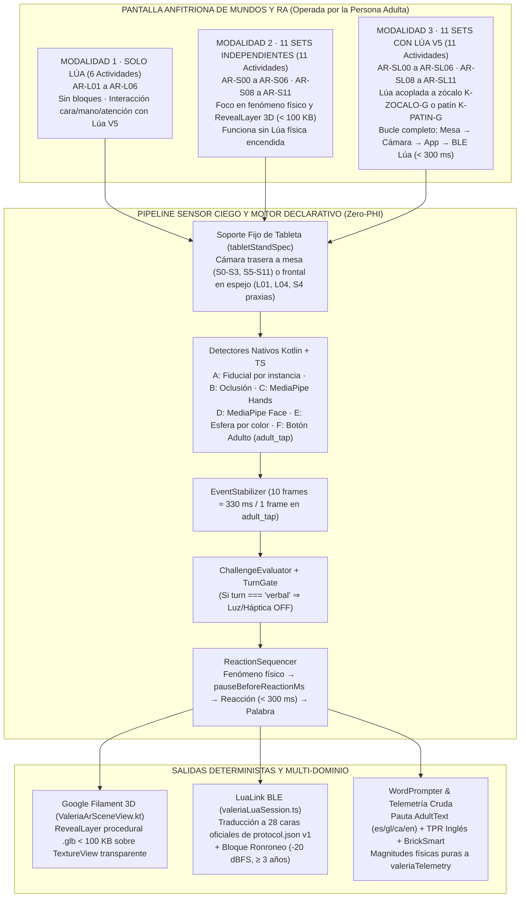

# Plan de Integración de Realidad Aumentada (v2.0) · Lúa V5 y los 11 Sets de Construye con Lúa en Valeria+

Estado: **Versión 2.0 auditada contra `Lua construye/sets/`, `lua-firmware` (V5), `PLAN-REFACTOR-STEAM.md` y los 30 gates de CI de Valeria+** · 30 de octubre de 2026.  
Ubicación canónica: `docs/PLAN-INTEGRACION-AR-LUA-CONSTRUYE.md` (rama `game`).

Convenciones epistemológicas (taxonomía obligatoria):
- **`[Hecho confirmado]`**: Verificado empíricamente en los repositorios (`Valeria/`, `Lua construye/`, `Proyecto Lua/lua-firmware/`), en `firmware/lua/protocol.json` v1 o en `docs/decisiones-v5.md`.
- **`[Inferencia]`**: Deducción técnica directa derivada de las restricciones geométricas, ópticas o de protocolo.
- **`[Propuesta]`**: Decisión arquitectónica, pedagógica o mecánica de juego reversible diseñada para la rama `game`.
- **`[Dato por validar]`**: Umbral físico o de visión artificial que requiere ensayo de banco con piezas impresas por *masque3d* y tableta en soporte fijo.

---

## 0. Síntesis Ejecutiva y Correcciones de Auditoría (v1.0 $\rightarrow$ v2.0)

El presente documento integra en el módulo de Realidad Aumentada de **Valeria+** tanto el muñeco físico **Lúa V5** (del repositorio `lua-firmware`) como los **11 sets de construcción manipulativa** (del repositorio `Lua construye/sets/`), estructurando **28 actividades** divididas en **tres modalidades operativas**:
1. **Modalidad I · Solo Lúa (`LUA_SOLO`, 6 actividades: `AR-L01` a `AR-L06`)**: Actividades centradas exclusivamente en la interacción motora, expresiva y de atención conjunta con Lúa V5 (y el bloque háptico opcional *Ronroneo*), sin requerir sets de bloques sobre la mesa.
2. **Modalidad II · Los 11 Sets de Forma Independiente (`SET_SOLO`, 11 actividades: `AR-S00` a `AR-S06` y `AR-S08` a `AR-S11`)**: Actividades donde la criatura construye y experimenta con cada uno de los 11 sets físicos por separado y la tableta proyecta la **Capa de Revelación (`RevealLayer`)** que hace visible el fenómeno físico invisible (caudal, resonancia, gravedad, viento, par de fuerzas, fototropismo, orden vial, hidráulica, pulso de calma y tracción ferroviaria), sin exigir que Lúa física esté encendida ni acoplada.
3. **Modalidad III · Los 11 Sets Integrados con Lúa V5 (`SET_WITH_LUA`, 11 actividades: `AR-SL00` a `AR-SL06` y `AR-SL08` a `AR-SL11`)**: Actividades simbióticas donde Lúa V5 se acopla físicamente al mundo (mediante el zócalo universal `K-ZOCALO-G` o deslizándose con su patín `K-PATIN-G`), cerrando el ciclo de cinco eslabones entre la acción en mesa, la cámara de la tableta, el motor declarativo de eventos y la reacción física de Lúa por BLE en $< 300\text{ ms}$.

### 0.1 Tabla de Mejoras y Correcciones de Auditoría incorporadas en v2.0

| # | Brecha detectada en el borrador v1.0 | Fuente de Contraste | Corrección Canónica Aplicada en v2.0 |
| :- | :--- | :--- | :--- |
| **C1** | El borrador v1.0 encuadraba el módulo bajo «SaMD Clase I» y utilizaba términos como «rehabilitación», «terapia», «desensibilización» y «paciente». | `PLAN-REFACTOR-STEAM.md` §0.1 (A1) y §7 · Regla de Producto P1 #4 | **`[Hecho confirmado]`** **Valeria+ es una aplicación educativa (No SaMD) y Zero-PHI.** Se elimina toda atribución diagnóstica o terapéutica y se aplica el vocabulario obligatorio («juego», «práctica», «acompañamiento», «niña/niño/criatura», «familiarización sensorial gradual»). |
| **C2** | En `AR-L02` y `AR-L03` v1.0 se proponía que el niño caminara con la tableta o deslizara el dedo sobre la pantalla (*fling*). | Regla de Producto P1 #1 («La criatura NO toca la pantalla») · Decisión D7 (`tabletStandSpec`) | **`[Hecho confirmado]`** La tableta permanece siempre en su **soporte fijo de sobremesa** (`tabletStandSpec`) o en manos de la persona adulta. La criatura **jamás toca la pantalla**: mueve a Lúa V5, manipula las piezas físicas o realiza gestos orofaciales/cefálicos/manuales en el aire. |
| **C3** | Se citaban cuatro luces físicas en el cuello de Lúa V5 como activas en hardware y el cuerpo antiguo de Set 0 (`72 × 64 mm` con patín recto de `50 mm`). | `lua-firmware/docs/decisiones-v5.md` (B1-B, B5-B) y `Lua construye/docs/ANALISIS-SETS-V1-LUA.md` | **`[Hecho confirmado]`** **B5-B cerró «NO luces de producto»** en el cuello físico de V5 (cuello sellado con batería **LiFePO4**, sin ventanas LED); `LightPattern` se renderiza como halo direccional en la escena RA de la tableta. El cuerpo es el de **Lúa V5** (base $\varnothing 104 \times 96\text{ mm}$ + patas) y el patín `K-PATIN-G` usa **dos clics y dos pivotes redondos** que pasan sin atasco por la curva de $r = 63,6\text{ mm}$ y la intersección en T. |
| **C4** | Se invocaban pseudo-opcodes inexistentes como `MOOD(GIRO_IZQ)`, `MOOD(SOPLO)`, `MOOD(MAREO)` o `MOOD(ALERTA)`. | `Valeria/firmware/lua/protocol.json` v1 y `scripts/check-lua-mascot-mirror.js` | **`[Hecho confirmado]`** En `protocol.json` v1, `MOOD (0x0B)` solo admite `0..4` (`SERENE`, `CRAVING`, `PURRING`, `EATING`, `CELEBRATING`). Todas las reacciones de las 28 actividades pasan por la **Tabla de Traducción Semántica de `LuaLink`** hacia las **28 caras oficiales (#0–#27)** mediante `IDLE`, `PHASE`, `VERDICT`, `CELEBRATE`, `AFFECT`, `PICTO`, `AWARD`, `MOOD`, `ACCESSORY` y `RELAX`. |
| **C5** | Los 11 sets se trataban como si todos tuvieran el mismo estado de despiece CAD en `Lua construye/sets/`. | `Lua construye/STATUS.md`, `sets/lote-ejecucion.json` y `agents/manual_ikea.py` | **`[Hecho confirmado]`** Se distingue con honestidad técnica entre el **Grupo Fundacional (`S0`–`S6` + `P1`)**, que cuenta con 83 piezas paramétricas auditadas y listas para impresión en `entrega/masque3d-sets-v1/`, y el **Grupo de Comunidad y Oficios (`S8`–`S11`)**, cuyas mallas actuales en `sets/S8..S11/stl/` son escenas monolíticas de `escenas-juego/oficios/` que en RA v2.0 operan mediante **Tarjetas de Escena Fiduciales + Construcción Modular Combinada** (reutilizando baldosas de `S1`, rampas de `S3`, vigas de `S5` y zócalos de `S0`) mientras se completa su partición en bloques imprimibles. |
| **C6** | Faltaba la estructura pedagógica estandarizada y la distinción de los dos ejes de localización de Valeria+. | `PLAN-REFACTOR-STEAM.md` §0.2 (G2 y G6) | **`[Propuesta]`** Cada una de las 28 actividades define su **Ciclo Didáctico Tripartito** (*1. Observa [5 s de silencio] $\rightarrow$ 2. Experimenta [Pistas N1/N2] $\rightarrow$ 3. Construye*), su estadio de neurodesarrollo (`I1` a `I5`), comando TPR en inglés, categoría espacial *BrickSmart* y separación estricta entre `AdultText` (`UiLang`: `es`, `en`, `ca`, `gl`) y `ChildSpeechMap` (`Locale`: `es`, `gl`, `eu`, `es-DO`, `en-US`, `ca`). |

---

## 1. Auditoría Empírica de los Repositorios Fuente

### 1.1 Auditoría de Lúa V5 en `Proyecto Lua/lua-firmware`

| Subsistema de Lúa V5 | Especificación Verificada en `lua-firmware` | Etiqueta | Implicación para el Módulo de RA de Valeria+ |
| :--- | :--- | :--- | :--- |
| **Conjunto A · Unidad Sellada (Cabeza v4 + Cuello)** | Cabeza v4 congelada y aceptada por Frank (28/10/2026): pantalla circular IPS **GC9A01 de $240\times 240\text{ px}$** sobre **ESP32-C3** (`board_v1.h`), unida de fábrica a un **bloque-cuello sellado** que aloja la celda **LiFePO4** (**Decisión B1-B**), protección térmica y carga USB-C empotrada con tapón para el adulto. Se abre solo con herramienta. | `[Hecho confirmado]` | La cabeza y el cuello constituyen una única pieza rígida e indivisible para el menor. No tiene micrófono ni altavoz físico: **toda locución sale de la tableta del adulto**. |
| **Anillo de Luz (`LIGHT`)** | **Decisión B5-B cerrada (28/10/2026): NO luces físicas de producto en el cuello V5.** El cuello se imprime macizo (paredes $\ge 3,2\text{ mm}$) sin ventanas difusoras. El opcode `LIGHT` y el bit `CAP_LIGHT` se mantienen en el protocolo como extensión controlada por puerta clínica (**B3-A**). | `[Hecho confirmado]` | En la sesión de RA, los patrones direccionales (`DIR_DELANTE`, `DIR_IZQ`, `DIR_DCHA`, `LADO_RAMPA`, `LADO_SOL`) se dibujan en la **Capa de Revelación (`RevealLayer`)** de la tableta alrededor del modelo/marcador de Lúa. |
| **Conjunto B · Cuerpo de Bloques y Patín (`cad/lua-v5/`)** | Cuerpo modular sin electrónica, sin tornillos, sin pegamento y sin imanes (entre 4 y 8 piezas grandes que superan el cilindro de piezas pequeñas EN 71-1 de $\varnothing 31,75\text{ mm}$). Base $\varnothing 104\times 96\text{ mm}$ con patas, llave asimétrica en el cuello (solo encaja mirando al frente), bloque dorsal `K-LOMO-G` plano mate para marcador RA, cola indicadora de rumbo y **patín `K-PATIN-G` con dos clics laterales y dos pivotes cilíndricos**. | `[Hecho confirmado]` | El marcador fiducial del lomo (`K-LOMO-G`) proporciona **posición 3D y vector de rumbo ($\psi$)** en todos los sets. Los dos pivotes cilíndricos del patín permiten recorrer tramos rectos, curvas de $90^\circ$ ($r = 63,6\text{ mm}$) y bifurcaciones en T sin bloqueo geométrico. |
| **Conjunto C · Bloque Háptico *Ronroneo* (`lua_v5_ronroneo.py`)** | Bloque independiente sellado de **$2\times 4$ módulos de altura doble** con ESP32-C3, actuador lineal resonante (**LRA**), celda LiPo $3,7\text{ V} \sim 500\text{ mAh}$ con PCM (**Decisión B2-B**). Topología BLE en estrella: la tableta es el único central; Lúa y *Ronroneo* no se comunican entre sí. Detención automática en $< 1\text{ s}$ si se pierde el latido BLE. | `[Hecho confirmado]` | Disponible solo para $\ge 3$ años (`neuroStage` `I4`–`I5`), activado manualmente por el adulto, siempre en nivel mínimo inicial, prohibido como señal de fallo y **bloqueado por `TurnGate` durante cualquier turno de escucha o respuesta verbal del menor**. |
| **Protocolo BLE (`firmware/lua/protocol.json` v1)** | Servicio GATT `4fafc201-1fb5-459e-8fcc-c5c9c331914b`. Opcodes de 3 bytes `[op, arg, flags]`: `PHASE (0x01)`, `VERDICT (0x02)`, `CELEBRATE (0x03)`, `IDLE (0x04)`, `HEARTBEAT (0x05)`, `AFFECT (0x06)`, `PICTO (0x07)`, `AWARD (0x08)`, `GRANT (0x09)`, `THRESHOLD (0x0A)`, `MOOD (0x0B)`, `ACCESSORY (0x0C)`, `RELAX (0x0D)`. Catálogo cerrado de **28 caras oficiales (#0 a #27)** en rejilla pixel art $24\times 24$. | `[Hecho confirmado]` | Garantiza latencia de reacción $< 300\text{ ms}$ y paridad exacta entre el cristal físico de Lúa y el componente `CatPixel` / `lua.glb` de la tableta (`check-lua-mascot-mirror.js`). |

### 1.2 Auditoría de la Carpeta `sets/` en `Lua construye`

El análisis exhaustivo de `/Lua construye/sets/`, `sets/lote-ejecucion.json`, `docs/SETS.md`, `docs/ANALISIS-SETS-V1-LUA.md` y `agents/manual_ikea.py` arroja la siguiente radiografía técnica de las **12 carpetas físicas** (1 probeta de calibración + 11 sets numerados `S0`–`S6` y `S8`–`S11`, además de la escena `S7-granja` en `escenas-juego/`):

| Código Carpeta | Nombre del Set (ES / GL) | Piezas STL | Estado CAD / Impresión (`STATUS.md`) | Fenómeno Físico / Dominio STEAM | Marcadores y Sensores RA Primarios |
| :--- | :--- | :---: | :--- | :--- | :--- |
| **`P1-probeta-encaje`** | Probeta de Calibración Mecánica | 12 | **`[Hecho confirmado]`** Auditado (`lote-ejecucion.json`), manual PDF compilado. | Ajuste de interferencia y holgura de espigas ($\Delta \in \{-0,15\dots +0,20\}\text{ mm}$) y carril de $12\text{ mm}$. | Utilizado en banco de taller (Fase 0/1); no requiere actividad infantil en app. |
| **`S0-kit-lua`** | **Set 0 · Kit Común Lúa** / *Kit Común Lúa* | 9 (+6 pilares) | **`[Hecho confirmado]`** Regenerado para Lúa V5: cuna con llave asimétrica, patín de 2 pivotes y 7 placas táctiles. | Anclaje espacial con orientación forzada (polaridad mecánica) e identificación contextual del mundo. | **A (`marker`)**: fiducial en `K-LOMO-G` y en las 7 placas `K-PLACA-*` (`INICIO`, `META`, `ESCUCHA`, `RECEPTOR`, `FRONTAL`, `NIVEL`, `JARDIN`) + **F (`adult_tap`)**. |
| **`S1-camino`** | **Set 1 · El Camino de Lúa** / *O Camiño de Lúa* | 18 | **`[Hecho confirmado]`** Regenerado con `agents.pipeline`: baldosas lisas/rugosas, curvas $90^\circ$, T, fichas TPR y destinos. | Algoritmo tangible desconectado: un recorrido es una secuencia ordenada de pasos; si falta una baldosa, el flujo se interrumpe. | **A (`marker`)**: `instanceMarkerIds` únicos por baldosa y ficha TPR (`AVANZA`, `GIRA_IZQ`, `GIRA_DCHA`, `SALTA`, `PARA`) + **F (`adult_tap`)**. |
| **`S2-estacion-sonido`** | **Set 2 · La Estación de Sonido y Eco** / *A Estación de Son e Eco* | 21 | **`[Hecho confirmado]`** Auditado: banco basculante, martillo con cunas en U, 9 resonadores (`AZU`/`AMA`/`ROJ` $\times$ `A/B/C`) y 2 raspadores guiro. | Acústica analógica: relación entre volumen de cavidad y altura tonal (grave/medio/agudo), e impulso mecánico e intensidad (fuerte/suave). | **A (`marker`)** en resonadores + **C (`hand`)** para raspado/percusión + ángulo del brazo martillo + **F (`adult_tap`)**. Pausa obligatoria de $1000\text{ ms}$ para no pisar el sonido real. |
| **`S3-laboratorio-rampas`** | **Set 3 · El Laboratorio de Rampas y Gravedad** / *O Laboratorio de Rampas* | 15 | **`[Hecho confirmado]`** Auditado: pilares `S3-PIL-1..6`, bisagra `S3-BIS-G`, rampa, tramo fricción `S3-FRI-G`, curva peraltada, receptor y 4 esferas $\varnothing 45\text{ mm}$. | Cinemática en plano inclinado: altura potencial vs. velocidad de llegada ($t_n$ vs $t_{n-1}$), disipación por textura rugosa y fuerza centrípeta en peralte. | **A (`marker`)** en pilares y tramo de fricción + **E (`tracked_object`)** por color para esferas $\varnothing 45\text{ mm}$ + **F (`adult_tap`)**. |
| **`S4-maquina-soplo`** | **Set 4 · La Máquina de Soplo y Viento** / *A Máquina de Sopro e Vento* | 10 | **`[Hecho confirmado]`** Auditado: jaulas abiertas por arriba con cunas en U (`ANALISIS-SETS-V1-LUA.md`), 2 canales, codo $90^\circ$, 2 rotores, 2 molinetes y 2 compuertas. | Neumática visible: conversión de caudal de aire expirado en rotación axial/tangencial y empuje diferencial sobre compuerta ligera vs. pesada. | **A (`marker`)** en ejes de rotor/molinete y compuertas + **D (`face`)** (blendshapes `mouthPucker`/`mouthFunnel` solo en modo praxias frontal) + **F (`adult_tap`)**. |
| **`S5-puente-equilibrio`** | **Set 5 · El Puente de Equilibrio y Fuerza** / *A Ponte de Equilibrio e Forza* | 14 | **`[Hecho confirmado]`** Auditado: fulcro prismático `S5-FUL-G`, viga `S5-VIG-G` con alvéolos a paso $31,8\text{ mm}$, masas calibradas ($20\text{ g}$, $40\text{ g}$, $60\text{ g}$) y clips pasadores en U. | Estática y ley de la palanca: equilibrio de momentos ($\sum m_{\text{izq}} d_{\text{izq}} = \sum m_{\text{der}} d_{\text{der}}$) y estabilidad estructural bajo carga. | **A (`marker`)** en viga (ángulo de inclinación $\theta$) y en masas por posición de alvéolo (`positionSlot` $1\dots 5$) + **F (`adult_tap`)**. |
| **`S6-jardin`** | **Set 6 · El Jardín del Sol, la Sombra y la Semilla** / *O Xardín do Sol, a Sombra e a Semente* | 14 | **`[Hecho confirmado]`** Auditado (incluye `sets/S6-jardin/ar/S6-TAL-G.glb`): base con alvéolos, cuadrante solar, tallo helicoidal, copa, flores y frutos. | Heliobiología y ciclos vitales: secuencia causal (*semilla $\rightarrow$ agua $\rightarrow$ luz $\rightarrow$ tallo $\rightarrow$ flor $\rightarrow$ fruto*) y proyección geométrica de sombras según el ángulo del sol. | **B (`occlusion`)** de alvéolos al sembrar + **C (`hand`)** al enroscar tallo y regar + **A (`marker`)** en cuadrante solar + **F (`adult_tap`)**. |
| **`S8-policia`** | **Set 8 · Estación de Policía y Tráfico** / *Estación de Policía e Tráfico* | 4 (en BOM manual) | **`[Hecho confirmado / Propuesta modular]`** En `sets/S8-policia/` existe la malla de escena (`escena.png` / `policia.stl`). En v2.0 se despieza en 4 bloques modulares compatibles con `S1` y `S5`. | Regulación de flujos viales, turnos de paso (*Go / No-Go*), trayectorias en rotonda y convivencia segura en comunidad. | **A (`marker`)** en tarjeta/base de estación, barrera basculante y patrulla sobre baldosas + **F (`adult_tap`)**. |
| **`S9-bomberos`** | **Set 9 · Parque y Estación de Bomberos** / *Parque e Estación de Bombeiros* | 4 (en BOM manual) | **`[Hecho confirmado / Propuesta modular]`** En `sets/S9-bomberos/` existe `S9-bomberos-escala-60.stl`. En v2.0 se articula con hangar, torre, camión y rampa compatible con `S3`. | Gravedad aplicada a respuesta rápida (descenso por rampa desde hangar) y trayectoria parabólica de chorro de agua virtual según inclinación. | **A (`marker`)** en hangar, torre y camión autobomba + **E (`tracked_object`)** en descenso por rampa + **F (`adult_tap`)**. |
| **`S10-hospital`** | **Set 10 · Hospital Infantil y Centro de Salud** / *Hospital Infantil e Centro de Saúde* | 4 (en BOM manual) | **`[Hecho confirmado / Propuesta modular]`** Escena en `sets/S10-hospital/`. En v2.0 se compone de pabellón de acogida, rampa suave, helipuerto superior y camilla de exploración para Lúa. | Familiarización afectiva con el entorno de salud, pérdida del miedo al instrumental pediátrico, autorregulación respiratoria y cuidado empático. | **A (`marker`)** en camilla pediátrica y helipuerto + **B (`occlusion`)** al acostar a Lúa en la camilla + **F (`adult_tap`)**. |
| **`S11-trenes`** | **Set 11 · Red de Trenes y Ferrocarril** / *Rede de Trens e Ferrocarril* | 7 (en BOM manual) | **`[Hecho confirmado / Propuesta modular]`** Escena en `sets/S11-trenes/`. En v2.0 integra estación con andén, 4 tramos de vía paso $31,8\text{ mm}$, barrera de paso a nivel y convoy (locomotora + vagón). | Tracción ferroviaria acoplada (arrastre magnético/mecánico de vagones), sincronización de cruces a nivel y conservación de rumbo en vía cerrada. | **A (`marker`)** en estación, barrera de paso a nivel y locomotora + **F (`adult_tap`)**. |

> [!NOTE]
> **Sobre `S7-granja` en `escenas-juego/escenas/`**: En la carpeta `escenas-juego/escenas/` existe además `S7-granja.stl`, mientras que en `sets/` y en `MANUAL-ENSAMBLAJE-IKEA-11-SETS.pdf` los **11 sets oficiales** son exactamente **`S0`, `S1`, `S2`, `S3`, `S4`, `S5`, `S6`, `S8`, `S9`, `S10` y `S11`**. Este plan cubre íntegramente esos **11 sets oficiales** de la carpeta `sets/`, dejando el esquema `WorldManifest` abierto por si en el futuro se incorpora `S7` como expansión.

---

## 2. Arquitectura Unificada Tri-Modal dentro del Módulo de RA

Para cumplir simultáneamente con la petición de tres catálogos diferenciados (**Solo Lúa**, **11 Sets Independientes** y **11 Sets con Lúa**) y con la arquitectura declarativa de `PLAN-REFACTOR-STEAM.md`, el motor de RA en `src/steam/` y `android-native/valeria-ar/` opera bajo un selector explícito de **Modalidad Operativa (`SteamArMode`)**:



### 2.1 Invariantes de Seguridad, Privacidad y Regulación en las 3 Modalidades

1. **La criatura NO toca la pantalla (Regla P1 #1)**: Toda selección de modalidad, activación de la capa de revelación (`RevealLayer`), confirmación por botón (`adult_tap`) y ajuste de perfil lo ejecuta la persona adulta.
2. **Cero datos personales y Sensor Ciego (Regla P1 #2)**: Los fotogramas de `Camera2` / `ARCore` se procesan en memoria volátil y se descartan en el mismo ciclo de reloj. Jamás se persisten fotos, vídeos ni nubes de puntos.
3. **Respaldo Universal `adult_tap` (100 % jugable sin cámara)**: En las 28 actividades, el adulto dispone en todo momento de botones táctiles claros para confirmar el evento físico si la iluminación del aula o del hogar impide la visión artificial.
4. **Silencio Respetuoso del Fenómeno Físico (`pauseBeforeReactionMs`)**: En los sets donde el juguete produce un estímulo acústico o mecánico propio (especialmente Set 2 con $1000\text{ ms}$ y Set 3 con $500\text{ ms}$), la tableta guarda silencio hasta que el fenómeno físico concluye antes de animar a Lúa o sugerir la palabra.
5. **El pulso musical se ve, no se oye (Regla P3 #1)**: En actividades rítmicas (`AR-S02`, `AR-SL02`), el metrónomo es exclusivamente luminoso/visual (`screenOverlay: 'VISUAL_METRONOME'`) para no interferir con procesadores de implante coclear ni audífonos.

---

## 3. Catálogo 1 · Actividades Específicas Solo para Lúa V5 (`AR-L01` a `AR-L06`)

Estas **6 actividades** están diseñadas para jugarse únicamente con el muñeco **Lúa V5** (montado sobre su cuerpo de bloques Conjunto B y, opcionalmente en $\ge 3$ años, acompañado del bloque *Ronroneo* Conjunto C) o con su gemelo 3D (`models/lua.glb` y `models/lua_v5_body.glb`) cuando no se dispone del hardware. Reutilizan y encapsulan los motores matemáticos validados de `Ar1Orofacial.kt` a `Ar6BuddyMimicry.kt` sin romper ninguno de los 4 gates nativos de CI.

| ID | Título (`es` / `gl`) | Estadio y Edad | Cámara y Detector | Expresión `LuaLink` (`protocol.json` v1) | Eje de Habilidad y Comando TPR |
| :--- | :--- | :---: | :--- | :--- | :--- |
| **`AR-L01`** | **El Espejo de Gestos de Lúa** / *O Espello de Xestos de Lúa* | `I3`–`I5` (2–6 a) | Frontal espejo · **D (`face`)** (`Ar1Orofacial.kt`: `pucker`, `funnel`, `jawOpen`) + **F (`adult_tap`)** | Inicio: `#1 Atenta` (`PHASE 0`) $\rightarrow$ Sostén: `#2 Animando` (`PHASE 1`) $\rightarrow$ Meta: `#4 Lo dijo` (`CELEBRATE 0`) | Motricidad oral lúdica (sin fonación exigida) · *"Round lips! Smile with Lúa!"* |
| **`AR-L02`** | **¿Hacia Dónde Mira Lúa?** / *Cara a Onde Mira Lúa?* | `I2`–`I5` (1–6 a) | Trasera soporte fijo · **A (`marker`)** en lomo `K-LOMO-G` (vector de rumbo $\psi$) + **F (`adult_tap`)** | Giro detectado: `#16 Inspiración` (`AFFECT 6`) $\rightarrow$ Alineada con placa: `#10 Alegría` (`AFFECT 0`) | Orientación espacial y perspectiva (deícticos y rumbo) · *"Turn Lúa around! Look forward!"* |
| **`AR-L03`** | **La Merienda del Pez Dorado** / *A Merenda do Peixe Dourado* | `I2`–`I4` (1–4 a) | Trasera soporte fijo · **B (`occlusion`)** / **A (`marker`)** al acercar ficha/pieza de pez a la boca de Lúa + **F (`adult_tap`)** | Espera: `#20 Antojo / Craving` (`MOOD 1`) $\rightarrow$ Entrega: `#22 Comiendo` (`MOOD 3`) $\rightarrow$ Fin: `#15 Gratitud` (`AFFECT 5`) | Coordinación visomotriz de alcance y turno de entrega · *"Feed the fish to Lúa! Yummy!"* |
| **`AR-L04`** | **El Despertar Sereno de Lúa** / *O Espertar Sereno de Lúa* | `I3`–`I5` (2–6 a) | Frontal espejo · **D (`face`)** (`Ar3Fixation.kt` + `FrameGate` cono $\pm 12^\circ$ sostenido) + **F (`adult_tap`)** | Reposo: `#18 Dormida` (`RELAX 20`) $\rightarrow$ Calma sostenida: `#13 Tranquilidad` (`AFFECT 3`) $\rightarrow$ Despierta: `#14 Esperanza` (`AFFECT 4`) | Atención conjunta sostenida y autorregulación postural · *"Stay still and calm… Wake up, Lúa!"* |
| **`AR-L05`** | **La Caricia y el Ronroneo** / *A Caricia e o Rosmido* | `I4`–`I5` (3–6 a) | Trasera soporte fijo · **C (`hand`)** (MediaPipe Hands sobre el lomo de Lúa) + **F (`adult_tap`)** | Contacto suave: `#21 Ronroneo` (`MOOD 2`) + `HapticPattern: 'RONRONEO'` en bloque Conjunto C ($-20\text{ dBFS}$) | Regulación sensorial táctil y modulación de fuerza palmar · *"Gentle touch, soft paws, purr!"* |
| **`AR-L06`** | **¿Dónde Cantó el Pajarito?** / *Onde Cantou o Paxariño?* | `I1`–`I5` (0–6 a) | Frontal espejo · **D (`face`)** (`Ar2Vra.kt` giro cefálico $\ge \text{turnDeg}$ tras estímulo `StimulusPlayer.kt`) + **F (`adult_tap`)** | Pre-estímulo: `#0 Neutra` (`IDLE 0`) $\rightarrow$ Giro hacia fuente: `#12 Orgullo` (`AFFECT 2`) + `#4 Lo dijo` (`CELEBRATE 0`) | Percepción y localización auditiva espacial · *"Listen! Turn your head! Look there!"* |

### 3.1 Especificación Detallada y Ciclo Tripartito de las Actividades «Solo Lúa»

#### `AR-L01` · El Espejo de Gestos de Lúa (`LUA_SOLO`)
- **Fenómeno observable**: El rostro del menor frente al soporte fijo mueve de forma proporcional una estela luminosa (`RewardChannel` con progreso continuo y decaimiento suave sin reinicio brusco) que despierta la cara de Lúa. **El micrófono permanece estrictamente apagado**.
- **Ciclo Didáctico Tripartito**:
  - **1. Observa (5 s de silencio)**: El adulto coloca a Lúa física al lado del soporte de la tableta mostrando la cara `#1 Atenta`. En pantalla aparece el espejo con `lua.glb`. Pregunta socrática tras 5 s: *«Mira los bigotes de Lúa… ¿qué pasa en la barra mágica cuando ponemos boca de pompón?»*
  - **2. Experimenta**: El menor imita posturas labiales amplias (redondeo de beso o apertura vocal) sosteniéndolas durante `holdMs` ($800\text{–}2500\text{ ms}$). **Pista N1 (Socrática)**: *«¿Y si escondemos los labios o los estiramos despacito como si sopláramos una vela?»* **Pista N2 (Modelado físico)**: El adulto entra en el encuadre junto al menor y realiza el gesto a cámara lenta para que vea subir la barra verde.
  - **3. Construye**: El menor elige y coloca en el cuerpo de bloques de Lúa V5 la cola o un accesorio del armario (`ACCESSORY 0x0C`) cada vez que completa dos gestos sostenidos.
- **Magnitudes físicas registradas (Zero-PHI)**: `holdConfiguredMs`, `holdAchievedMs`, `peakRatio` (`mouthPucker` / `mouthFunnel`), `framesValid`, `framesTotal`, `thermalStatus`.

#### `AR-L02` · ¿Hacia Dónde Mira Lúa? (`LUA_SOLO`)
- **Fenómeno observable**: El cuerpo de bloques de Lúa V5 tiene una parte delantera (cara redonda y llave asimétrica del cuello) y una trasera (cola `K-COLA-G`). Al rotar a Lúa sobre la mesa, la brújula 3D proyectada por Filament sobre su lomo (`K-LOMO-G`) gira solidariamente e ilumina el objeto situado frente a sus ojos.
- **Ciclo Didáctico Tripartito**:
  - **1. Observa (5 s de silencio)**: El adulto gira a Lúa $90^\circ$ sobre la mesa. El haz de luz virtual en pantalla barre la mesa y apunta hacia una ficha. Silencio de 5 s. Pregunta: *«¿Adónde apunta ahora la nariz de Lúa?»*
  - **2. Experimenta**: El adulto coloca tres placas (`INICIO`, `JARDIN`, `META`) alrededor de Lúa y pide orientarla hacia cada una. **Pista N1**: *«Fíjate en su cola: si la cola mira hacia ti, ¿hacia dónde miran sus ojos?»* **Pista N2**: El adulto coloca a Lúa de espaldas al menor (regla de lateralidad de `SETS.md` §Set 0: la izquierda de Lúa coincide con la izquierda del niño) y la gira $90^\circ$ con él.
  - **3. Construye**: Desmontar y volver a montar la cabeza-cuello sellada sobre el tronco `K-TRONCO-G` comprobando cómo la llave asimétrica impide poner la cabeza mirando hacia la cola.
- **Magnitudes físicas registradas**: Ángulo de guiñada del marcador del lomo (`yawDeg`), error angular respecto a la placa objetivo (`deltaDeg`) y tiempo de estabilización (`durationMs`).

#### `AR-L03` · La Merienda del Pez Dorado (`LUA_SOLO`)
- **Fenómeno observable**: En lugar de tocar el cristal de la tableta (prohibido por Regla P1), el menor sostiene en su mano una pieza física (bloque con marcador o ficha) y la acerca en el espacio real de la mesa hasta la boca de Lúa V5 (o encuadra el gesto de entrega). Cuando entra en la zona de proximidad ($< 60\text{ mm}$ del zócalo frontal), el pez dorado 3D (`models/pez.glb`, animación `spin360`) salta en la pantalla de la tableta hacia Lúa y la pantalla circular de Lúa cambia de `#20 Antojo` (`MOOD 1: CRAVING`) a `#22 Comiendo` (`MOOD 3: EATING`).
- **Ciclo Didáctico Tripartito**:
  - **1. Observa (5 s de silencio)**: Lúa muestra en su pantalla redonda el icono de hambre (`MOOD 1`). El adulto acerca despacio un bloque por delante. A los 5 s pregunta: *«¿Qué ha hecho Lúa cuando el bloque llegó cerquita de su boca?»*
  - **2. Experimenta**: Practicar entregas suaves desde cerca, desde lejos, por arriba y por delante. **Pista N1**: *«¿La boca de Lúa está arriba en las orejas o delante en la cara?»* **Pista N2**: El adulto guía el codo del menor para realizar una aproximación pausada sin golpear la pantalla de Lúa.
  - **3. Construye**: Construir con 4 bloques una «bandeja de merienda» frente al zócalo de Lúa y clasificar piezas por color antes de dárselas.

#### `AR-L04` · El Despertar Sereno de Lúa (`LUA_SOLO`)
- **Fenómeno observable**: Lúa descansa con la cara `#18 Dormida` (`RELAX 20`). Cuando el menor mantiene su postura tranquila frente al espejo dentro del cono de $\pm 12^\circ$, un anillo de luz cálida (`PROGRESS_RING`) se llena suavemente sin estridencias hasta que Lúa abre los ojos con `#14 Esperanza` (`AFFECT 4`).
- **Ciclo Didáctico Tripartito**:
  - **1. Observa (5 s de silencio)**: Lúa duerme. El adulto se queda muy quieto frente a la cámara y el anillo empieza a brillar. Silencio de 5 s. Pregunta: *«¿Qué necesitamos hacer con el cuerpo para que el anillo de luz despierte a Lúa sin asustarla?»*
  - **2. Experimenta**: Sostener la mirada y la postura tranquila durante $1,5\text{–}3\text{ s}$. Si el menor se mueve un instante, el anillo decrece despacio pero no se borra a cero. **Pista N1**: *«Respira despacito como un gato dormido…»* **Pista N2**: El adulto apoya suavemente sus manos en los hombros del menor (presión firme reguladora) mientras miran juntos a Lúa.
  - **3. Construye**: Montar alrededor del zócalo de Lúa una «cama de noche» con dos baldosas lisas del Set 1 para acostarla al terminar.

#### `AR-L05` · La Caricia y el Ronroneo (`LUA_SOLO`, $\ge 3$ años con Conjunto C *Ronroneo*)
- **Fenómeno observable**: El menor acaricia con la palma abierta el lomo `K-LOMO-G` de Lúa V5 o posa la mano junto al bloque *Ronroneo* ($2\times 4$ módulos). MediaPipe Hands detecta el movimiento lento de la mano ($v < 120\text{ mm/s}$) y en la tableta florece una estela turquesa suave. Simultáneamente, Lúa muestra la cara `#21 Ronroneo` (`MOOD 2: PURRING`) y el bloque *Ronroneo* emite su vibración táctil a $-20\text{ dBFS}$. Si el movimiento es brusco o rápido, la estela se vuelve neutra y Lúa pasa a `#0 Neutra` (sin reproche ni castigo).
- **Ciclo Didáctico Tripartito**:
  - **1. Observa (5 s de silencio)**: El adulto acaricia despacio el lomo de Lúa y acerca el bloque *Ronroneo* a la mesa para que se sienta el cosquilleo suave. Silencio de 5 s. Pregunta: *«¿Cómo se siente en los dedos cuando acariciamos a Lúa muy despacito?»*
  - **2. Experimenta**: Diferenciar entre «mano rápida como lluvia» y «mano lenta como pluma». **Pista N1**: *«¿Con cuál de las dos manos empieza Lúa a ronronear?»* **Pista N2**: El adulto acaricia primero el dorso de la mano del menor al ritmo exacto para modelar la velocidad y presión suaves.
  - **3. Construye**: Encajar el bloque *Ronroneo* en una base de bloques junto a Lúa para crear el «rincón de calma».

#### `AR-L06` · ¿Dónde Cantó el Pajarito? (`LUA_SOLO`)
- **Fenómeno observable**: Integración del motor `Ar2Vra.kt` y `StimulusPlayer.kt`. La tableta emite un estímulo sonoro natural calibrado por el canal izquierdo o derecho; tras el giro cefálico del menor ($\ge \text{turnDeg}$) dentro de la ventana temporal, Lúa celebra en su pantalla física (`#4 Lo dijo`) y el modelo 3D (`models/lua.glb`) salta en el lado localizado.
- **Ciclo Didáctico Tripartito**:
  - **1. Observa (5 s de silencio)**: Suena el estímulo a un lado; el adulto gira la cabeza ostentosamente señalando la oreja y aparece Lúa brillando en ese lado. Silencio de 5 s.
  - **2. Experimenta**: Juego de escucha y orientación. En perfil `hearing_ic` (hipoacusia / implante coclear), el adulto puede activar el apoyo visual progresivo tras $1500\text{ ms}$. **Pista N1**: *«Ponemos las antenas de gato… ¿sonó por esta ventana o por la puerta?»* **Pista N2**: El adulto coloca a Lúa física en el lado por donde va a sonar el estímulo para anclar la referencia espacial.
  - **3. Construye**: Colocar una ficha de estrella junto a Lúa por cada sonido descubierto en equipo.

---

## 4. Catálogo 2 · Actividades para los 11 Sets de Forma Independiente (`AR-S00` a `AR-S06` y `AR-S08` a `AR-S11`)

En esta segunda modalidad (`SET_SOLO`), el protagonismo recae al **100 % en el mundo de bloques y su fenómeno físico**. No se requiere tener a Lúa V5 encendida ni conectada por BLE (el motor `LuaLink` permanece en modo silencioso o muestra únicamente el icono discreto de estado en la esquina del adulto), y la escena 3D de Filament proyecta la **Capa de Revelación (`RevealLayer`)** sobre las piezas físicas para hacer visible la física invisible (fuerzas, ondas, caudal, fricción, rayos solares y trayectorias).

### 4.1 Tabla Maestra de las 11 Actividades de Sets Independientes (`SET_SOLO`)

| ID | Set Físico (`Lua construye/sets/`) | Fenómeno Físico y Mecánica sin Lúa | Capa RA Visible (`RevealLayer` GLB $< 100\text{ KB}$) | Detectores Activos | Categoría *BrickSmart* y TPR |
| :--- | :--- | :--- | :--- | :--- | :--- |
| **`AR-S00`** | **`S0-kit-lua`** · El Taller de Encajes y Placas | Polaridad geométrica de la llave asimétrica y lectura táctil en relieve de las 7 placas de identidad (`K-PLACA-*`). | `set_kit_s0.glb`: Contorno luminoso de encaje y holograma del símbolo de cada placa al insertarla en el zócalo `K-ZOCALO-G`. | **A (`marker`)** en placas + **B (`occlusion`)** de ranura + **F (`adult_tap`)** | `orientation`, `shapes` · *"Fit it in! Match the shape!"* |
| **`AR-S01`** | **`S1-camino`** · El Río de Baldosas Conectadas | Continuidad topológica de un grafo físico: el caudal solo llega de `INICIO` a `META` si las ranuras de $12\text{ mm}$ están empalmadas sin saltos. | `set_camino.glb` (anim `flow`): Corriente de agua/luz turquesa que recorre las baldosas unidas y se detiene con remolino amable donde falta un tramo. | **A (`marker`)** (`instanceMarkerIds` por baldosa y ficha) + **F (`adult_tap`)** | `position`, `orientation`, `pattern` · *"Connect the path! Smooth, rough, turn!"* |
| **`AR-S02`** | **`S2-estacion-sonido`** · El Laboratorio de Ondas y Cavidades | Acústica física: el tamaño de la cavidad del resonador (`ROJ` grande, `AMA` medio, `AZU` pequeño) determina el tono, y la altura desde la que cae el brazo martillo determina la intensidad. | `set_sonido.glb` (anim `resonate`): Anillos concéntricos 3D (anchos y cálidos en graves; cerrados y vivos en agudos) + `VISUAL_METRONOME` mudo. | **A (`marker`)** en resonadores + ángulo de `S2-BAL-BRAZO-E` + **C (`hand`)** + **F (`adult_tap`)** | `dimensions`, `properties`, `pattern` · *"Big and low! Small and high! Scrape slow!"* |
| **`AR-S03`** | **`S3-laboratorio-rampas`** · La Pista de Gravedad y Texturas | Energía potencial ($\text{pilar } 1\dots 6$), disipación por rozamiento en tramo estriado (`S3-FRI-G`) y guiado centrípeto en curva peraltada con esferas de $\varnothing 45\text{ mm}$. | `set_rampas.glb` (anim `roll`): Arco balístico y estela de velocidad comparativa ($v_n$ vs $v_{n-1}$) coloreada sobre la rampa. | **A (`marker`)** en pilares y rampa + **E (`tracked_object`)** esfera $\varnothing 45\text{ mm}$ + **F (`adult_tap`)** | `dimensions`, `properties`, `deictics` · *"High tower! Roll down! Fast, slow, stop!"* |
| **`AR-S04`** | **`S4-maquina-soplo`** · El Molino de Aire y Compuertas | Dinámica de fluidos: canalización del aire por tramo recto (`S4-CAN-E`) y codo de $90^\circ$ (`S4-COD-E`) para vencer la inercia del rotor, el molinete o las compuertas ligera y pesada. | `set_soplo.glb` (anim `spin_rotor`): Líneas de corriente laminar y cintas de viento que recorren el canal y envuelven las aspas al girar. | **A (`marker`)** en rotores y compuertas + **D (`face`)** opcional + **F (`adult_tap`)** | `properties`, `orientation`, `quantity` · *"Blow gently! Blow strong! Spin the wheel!"* |
| **`AR-S05`** | **`S5-puente-equilibrio`** · La Balanza de Momentos y Palancas | Estática de cuerpos rígidos: una masa de $40\text{ g}$ en el alvéolo 2 equilibra una de $20\text{ g}$ en el alvéolo 4 ($40\times 2 = 20\times 4$). | `set_puente.glb` (anim `balance`): Flechas verticales proporcionales al par ($m\cdot d$) bajo cada alvéolo y plomada luminosa en el fulcro `S5-FUL-G`. | **A (`marker`)** en viga `S5-VIG-G` y masas ($20/40/60\text{ g}$) + **F (`adult_tap`)** | `quantity`, `position`, `dimensions` · *"Heavy, light, level the bridge!"* |
| **`AR-S06`** | **`S6-jardin`** · El Reloj de Sol y el Árbol en Espiral | Ciclo botánico causal y gnomónica: al rotar el cuadrante solar, la sombra del tallo helicoidal `S6-TAL-G` gira en sentido opuesto en la mesa. | `sets/S6-jardin/ar/S6-TAL-G.glb` + `set_jardin.glb` (anim `bloom`): Arco solar virtual, proyección del cono de sombra y apertura de pétalos. | **B (`occlusion`)** en alvéolos + **C (`hand`)** giro de tallo + **A (`marker`)** en sol + **F (`adult_tap`)** | `orientation`, `position`, `pattern` · *"Plant the seed! Pour water! Turn the sun!"* |
| **`AR-S08`** | **`S8-policia`** · El Cruce de Convivencia y Turnos Viales | Coordinación de trayectorias en intersecciones y rotondas: si dos vehículos entran al mismo tiempo sin turno (*Go / No-Go*), el paso se bloquea. | `set_oficios.glb` (nodo `policia`, anim `celebrate`): Paso de cebra luminoso sobre la mesa, flechas de sentido giratorio en rotonda y barrera de luz. | **A (`marker`)** en tarjeta/base S8, barrera y vehículo + **F (`adult_tap`)** | `position`, `orientation`, `deictics` · *"Wait your turn! Green light, go! Stop at the crossing!"* |
| **`AR-S09`** | **`S9-bomberos`** · El Hangar de Salida Gravitatoria y el Agua | Conversión de altura de la rampa del hangar en alcance horizontal y parábola de chorro de agua según el ángulo de elevación de la torre. | `set_oficios.glb` (nodo `bomberos`, anim `celebrate`): Arco parabólico de gotas de agua azules desde la torre hacia dianas de espuma en la mesa. | **A (`marker`)** en hangar, rampa y camión + **E (`tracked_object`)** + **F (`adult_tap`)** | `dimensions`, `position`, `orientation` · *"Open the gate! Slide down the ramp! Aim high!"* |
| **`AR-S10`** | **`S10-hospital`** · El Pabellón de Cuidados y Calma |Accesibilidad física (rampa suave de ambulancia vs. escalón) y ritmo de respiración pausada (inspirar en 3 s, espirar en 3 s). | `set_oficios.glb` (nodo `hospital`, anim `celebrate`): Onda sinusoidal serena de respiración sobre la camilla y pista iluminada de aterrizaje en el helipuerto. | **A (`marker`)** en pabellón, rampa y camilla + **F (`adult_tap`)** | `position`, `properties`, `deictics` · *"Up the gentle ramp! Breathe slow and calm!"* |
| **`AR-S11`** | **`S11-trenes`** · El Circuito Ferroviario y el Paso a Nivel | Continuidad de vía cerrada, radio mínimo de giro y sincronización mecánica entre la llegada del convoy y el descenso de la barrera basculante. | `set_oficios.glb` (nodo `trenes`, anim `celebrate`): Estela luminosa sobre los carriles de paso $31,8\text{ mm}$ y aviso visual de cantón ocupado en el cruce. | **A (`marker`)** en estación, tramos de vía, barrera y locomotora + **F (`adult_tap`)** | `pattern`, `position`, `quantity` · *"Link the wagon! Lower the barrier! Chug along the track!"* |

### 4.2 Especificación Pedagógica y Ciclo Tripartito de los Sets Independientes (`AR-S00` a `AR-S11`)

1. **`AR-S00` (Set 0 · Kit Común)**:
   - *Observa (5 s)*: El adulto desliza la placa `K-PLACA-JARDIN` en el zócalo `K-ZOCALO-G` con vector $(0,0,-1)$; la tableta ilumina el relieve táctil.
   - *Experimenta*: La criatura explora al tacto con los ojos abiertos o entornados los relieves de las 7 placas (`INICIO`, `META`, `ESCUCHA`, `RECEPTOR`, `FRONTAL`, `NIVEL`, `JARDIN`) y las inserta una a una.
   - *Construye*: Emparejar los dos zócalos universales con las placas `INICIO` y `META` a una distancia de 3 módulos de mesa.
2. **`AR-S01` (Set 1 · El Camino)**:
   - *Observa (5 s)*: Dos baldosas rectas unidas dejan pasar el río de luz de `set_camino.glb`; al separar la segunda baldosa $2\text{ cm}$, el flujo se detiene suavemente en el borde.
   - *Experimenta*: Alternar baldosas lisas (`S1-REC-LIS-G`) y rugosas (`S1-REC-RUG-G`) tocando su textura con la palma de la mano antes de encajarlas, y probar giros de $90^\circ$ (`S1-CUR-G`).
   - *Construye*: Copiar una de las 4 tarjetas de modelo en papel (`S1-CARD-1..4`, marco de Gilligan-Lee *et al.*, 2023) tendiendo un puente continuo con desvío en T (`S1-TEE-G`).
3. **`AR-S02` (Set 2 · Estación de Sonido)**:
   - *Observa (5 s + $1000\text{ ms}$ de silencio acústico post-impacto)*: El adulto suelta el brazo percutor `S2-BAL-BRAZO-E` sobre el resonador rojo grande y luego sobre el azul pequeño. La tableta espera $1000\text{ ms}$ en absoluto silencio para que el sonido acústico del PLA resuene limpio y luego dibuja la onda 3D.
   - *Experimenta*: Ordenar los cilindros de grave a agudo y raspar las estrías del guiro `S2-RAS-E` siguiendo el metrónomo visual mudo (`VISUAL_METRONOME`).
   - *Construye*: Crear un patrón sonoro ABAB (golpe grave – raspado – golpe grave – raspado) usando los bloques como partitura física sobre la mesa.
4. **`AR-S03` (Set 3 · Laboratorio de Rampas)**:
   - *Observa (5 s)*: Lanzar la esfera lisa `S3-ESF-LIS-G` desde el pilar 2 y luego desde el pilar 6; la Capa de Revelación muestra lado a lado los dos arcos de velocidad ($v_2 > v_1$).
   - *Experimenta*: Intercalar el tramo estriado de fricción `S3-FRI-G` y lanzar la esfera rugosa `S3-ESF-RUG-G` para observar cómo pierde velocidad antes de la curva peraltada `S3-CUR-PER-G`.
   - *Construye*: Ajustar la altura de los pilares para que la esfera llegue suavemente y se detenga justo dentro del módulo receptor `S3-REC-G` sin salirse.
5. **`AR-S04` (Set 4 · Máquina de Soplo)**:
   - *Observa (5 s)*: El adulto sopla suavemente por el canal `S4-CAN-E` (con boquilla individual higienizable): la compuerta ligera `S4-COM-LIG-E` se levanta, mientras que la pesada `S4-COM-PES-E` apenas oscila.
   - *Experimenta*: Redirigir el flujo de aire acoplando el codo de $90^\circ$ `S4-COD-E` hacia la jaula del rotor tangencial y luego hacia el molinete axial.
   - *Construye*: Diseñar un circuito neumático en L que mueva primero las aspas del molinete y al final levante la compuerta ligera.
6. **`AR-S05` (Set 5 · Puente de Equilibrio)**:
   - *Observa (5 s)*: Colocar la masa de $60\text{ g}$ en un extremo de la viga `S5-VIG-G` apoyada sobre el fulcro `S5-FUL-G`; la flecha de momento en RA se alarga y la viga bascula.
   - *Experimenta*: Descubrir equivalencias sin números escritos: equilibrar $40\text{ g}$ usando dos piezas de $20\text{ g}$, o acercando la pieza más pesada hacia el centro del fulcro.
   - *Construye*: Asegurar la viga equilibrada con los 4 clips pasadores en U (`S5-PAS-G`) para transformarla en un puente firme por el que puedan cruzar vehículos.
7. **`AR-S06` (Set 6 · Jardín del Sol)**:
   - *Observa (5 s)*: Encajar el tallo en espiral `S6-TAL-G` y girar el bloque del sol alrededor de la placa base; la sombra real y la sombra proyectada en RA giran sobre los alvéolos.
   - *Experimenta*: Sembrar en los alvéolos (oclusión `B`), hacer el gesto de regar y enroscar con rotación de muñeca la copa `S6-COP-G`, las flores `S6-FLO-G` y los frutos (`S6-FRU-MANZ`, `S6-FRU-NAR`).
   - *Construye*: Clasificar la cosecha por forma y tamaño situando las flores al sol y las semillas a la sombra de la copa.
8. **`AR-S08` (Set 8 · Policía y Tráfico)**:
   - *Observa (5 s)*: La patrulla se detiene ante la barrera bajada; el paso peatonal en RA se ilumina en verde para que crucen los peatones.
   - *Experimenta*: Alternar roles entre quien levanta la barrera (control de parada/paso) y quien desplaza el vehículo respetando el giro en la rotonda.
   - *Construye*: Unir las baldosas rectas y la intersección en T del Set 1 con la base de la estación `S8` para formar una avenida con cruce regulado.
9. **`AR-S09` (Set 9 · Parque de Bomberos)**:
   - *Observa (5 s)*: Al abrir el portón del hangar `S9-BOM-BASE`, el camión autobomba desciende por su propio peso por la rampa `S9-BOM-RAMPA`.
   - *Experimenta*: Orientar la torre `S9-BOM-TORRE` hacia tres focos de espuma virtuales en la mesa, comprobando cómo cambia el alcance del arco de agua en RA.
   - *Construye*: Acoplar los pilares graduados del Set 3 bajo la rampa del parque de bomberos para comparar una salida suave frente a una salida rápida.
10. **`AR-S10` (Set 10 · Hospital Infantil)**:
    - *Observa (5 s)*: Subir la camilla `S10-HOS-CAMI` por la rampa suave `S10-HOS-RAMPA` hasta el pabellón de admisión; la onda luminosa de calma en RA late despacio.
    - *Experimenta*: Practicar los pasos de una revisión amable (saludar en admisión, escuchar el latido tranquilo, descansar en la camilla, despegar en el helipuerto `S10-HOS-HELI`).
    - *Construye*: Montar una rampa de acceso sin escalones conectando el camino del Set 1 con la entrada del hospital infantil.
11. **`AR-S11` (Set 11 · Red de Trenes)**:
    - *Observa (5 s)*: Empujar la locomotora `S11-TRE-CONV` sola y luego enganchada al vagón cargado con una masa del Set 5; sentir en la mano la diferencia de empuje.
    - *Experimenta*: Bajar la barrera basculante `S11-TRE-BARR` antes de que el tren pase por el cruce y detener el convoy exactamente frente al andén `S11-TRE-ESTA`.
    - *Construye*: Integrar el puente del Set 5 en mitad del trazado de vías `S11-TRE-VIAS` para que el tren cruce por encima de un río imaginario.

---

## 5. Catálogo 3 · Actividades de los 11 Sets Integrados con Lúa V5 (`AR-SL00` a `AR-SL06` y `AR-SL08` a `AR-SL11`)

En esta tercera modalidad (`SET_WITH_LUA`), **Lúa V5 física** entra en escena acoplada al mundo mediante su patín de dos pivotes (`K-PATIN-G`) o asentada en el zócalo universal (`K-ZOCALO-G`) con su placa de identidad correspondiente (`K-PLACA-*`). Cada evento físico confirmado por la tableta dispara en $< 300\text{ ms}$ (respetando `pauseBeforeReactionMs` y `TurnGate`) la reacción en la pantalla circular de $240\times 240\text{ px}$ de Lúa V5, el espejo visual en la tableta y, cuando procede en $\ge 3$ años, el bloque *Ronroneo*.

### 5.1 Matriz de Contratos de Eventos, Opcodes Reales `protocol.json` v1 y Mediación (`SET_WITH_LUA`)

| ID Actividad | Set + Anclaje de Lúa V5 | Eventos Canónicos del Motor (`WorldEventSpec.id`) | Traducción Exacta `LuaLink` $\rightarrow$ `protocol.json` v1 (Cara #0–#27) | Luz RA (`RevealLayer`) y Háptica (*Ronroneo*) | Ciclo de Mediación Adulta y Vocabulario |
| :--- | :--- | :--- | :--- | :--- | :--- |
| **`AR-SL00`** | **S0 + Lúa · El Anclaje Maestro** (`K-ZOCALO-G` + 7 placas) | `S0.CABEZA_ENCAJADA`<br>`S0.LUA_EN_ZOCALO`<br>`S0.PLACA_LEIDA` | `AFFECT(6)` **#16 Inspiración** $\rightarrow$ `PHASE(0)` **#1 Atenta** $\rightarrow$ `CELEBRATE(0)` **#4 Lo dijo** + `PICTO` de la placa | Luz RA: `TENUE_CUATRO` alrededor del zócalo · Háptica: `CELEBRA_CORTO` al asentar en cuna | La llave asimétrica enseña delante/detrás sin palabras. *«Delante, detrás, encajar, dentro, fuera»*. |
| **`AR-SL01`** | **S1 + Lúa · Lúa Recorre el Camino** (Patín `K-PATIN-G` en ranura $12\text{ mm}$) | `S1.LUA_EN_INICIO`<br>`S1.LUA_AVANZA`<br>`S1.LUA_GIRA`<br>`S1.CAMINO_ROTO`<br>`S1.LLEGA_META` | Inicio: `PHASE(0)` **#1 Atenta**<br>Avanza/Gira: `PHASE(1)` **#2 Animando** + `PICTO(flecha)`<br>Camino roto: `IDLE(0)` **#0 Neutra** (sin error)<br>Meta: `CELEBRATE(2)` **#9 Éxito** + `AWARD(0)` | Luz RA: `DIR_DELANTE` / `DIR_IZQ` / `DIR_DCHA` según ficha TPR · Háptica: `CELEBRA_CORTO` en `META` | El niño desliza a Lúa viéndola desde atrás (su izq. = izq. de Lúa). Si falta baldosa, Lúa espera serena. *«Primero, después, gira a la izquierda, al final»*. |
| **`AR-SL02`** | **S2 + Lúa · Lúa Escucha el Eco** (Zócalo `K-PLACA-ESCUCHA`) | `S2.RESONADOR_COLOCADO`<br>`S2.GOLPE_FUERTE`<br>`S2.GOLPE_DEBIL`<br>`S2.RASPADO_COMPLETO`<br>`S2.PULSO_SEGUIDO` | Colocado: `PHASE(0)` **#1 Atenta**<br>Fuerte (tras $1\text{ s}$): `AFFECT(0)` **#10 Alegría**<br>Suave (tras $1\text{ s}$): `VERDICT(2)` **#7 Calma**<br>Pulso: `CELEBRATE(1)` **#5 Nivel** | `pauseBeforeReactionMs: 1000` obligatorio · `VISUAL_METRONOME` en pantalla · Háptica: `METRONOMO_LENTO` solo en fase pre-percusión | La tableta y Lúa jamás interrumpen el timbre físico del resonador. *«Grave, agudo, fuerte, flojo, después del golpe»*. |
| **`AR-SL03`** | **S3 + Lúa · Lúa en la Meta de Gravedad** (Zócalo `K-PLACA-RECEPTOR` al pie de rampa) | `S3.ESFERA_ARRIBA`<br>`S3.SALIDA_ANTICIPADA`<br>`S3.LLEGADA_RAPIDA`<br>`S3.LLEGADA_LENTA`<br>`S3.SE_PARA` | Arriba: `AFFECT(6)` **#16 Inspiración**<br>Anticipada: `PHASE(0)` **#1 Atenta**<br>Rápida ($t_n < t_{n-1}$): `CELEBRATE(0)` **#4 Lo dijo**<br>Lenta ($t_n > t_{n-1}$): `VERDICT(2)` **#7 Calma** | Luz RA: `LADO_RAMPA` siguiendo la esfera $\varnothing 45\text{ mm}$ · Háptica: `CELEBRA_CORTO` al tocar el tope receptor | Predicción antes de soltar (*«¿Llegará antes por la rampa alta o por la rugosa?»*). *«Alto, bajo, rápido, lento, rozamiento»*. |
| **`AR-SL04`** | **S4 + Lúa · El Molino que Sopla con Lúa** (Zócalo `K-PLACA-FRONTAL`) | `S4.ROTOR_GIRA`<br>`S4.MOLINETE_GIRA`<br>`S4.COMPUERTA_LIGERA`<br>`S4.COMPUERTA_PESADA`<br>`S4.PRAXIA_REDONDEO` | Rotor/Molinete: `AFFECT(7)` **#17 Diversión**<br>Compuerta ligera: `AFFECT(0)` **#10 Alegría**<br>Compuerta pesada: `AFFECT(2)` **#12 Orgullo**<br>Praxia: `PHASE(1)` **#2 Animando** | Luz RA: `DIR_DELANTE` como estela de aire · Háptica: `APAGADO` durante todo el soplo (`TurnGate`) | El niño ve a Lúa de frente al final del canal de aire; el esfuerzo del soplo tiene respuesta física inmediata en las aspas y emocional en Lúa. *«Soplar largo, suave, fuerte, girar»*. |
| **`AR-SL05`** | **S5 + Lúa · Lúa Vigila el Puente** (Zócalo `K-PLACA-NIVEL` frente al fulcro) | `S5.MASA_COLOCADA`<br>`S5.INCLINA_IZQ`<br>`S5.INCLINA_DCHA`<br>`S5.EQUILIBRIO`<br>`S5.PUENTE_ESTABLE` | Masa: `PHASE(0)` **#1 Atenta**<br>Inclina ($\|\theta\| > 4^\circ$): `AFFECT(7)` **#17 Diversión**<br>Equilibrio ($\|\theta\| \le 1,5^\circ$): `AFFECT(3)` **#13 Tranquilidad**<br>Puente con clips: `CELEBRATE(2)` **#9 Éxito** | Luz RA: `DIR_IZQ` o `DIR_DCHA` hacia el brazo que baja, `TENUE_CUATRO` en equilibrio · Háptica: `RONRONEO` suave al lograr equilibrio | Lúa observa el puente desde atrás (su izq. coincide con el brazo izq. de la viga). *«Pesa más, pesa menos, igual, centro, lejos, cerca»*. |
| **`AR-SL06`** | **S6 + Lúa · Lúa Cuida el Jardín** (Zócalo `K-PLACA-JARDIN` junto al árbol) | `S6.SIEMBRA`<br>`S6.RIEGO`<br>`S6.BROTE`<br>`S6.SOMBRA_ALINEADA`<br>`S6.FLORECE`<br>`S6.NOCHE` | Siembra: `AFFECT(1)` **#11 Ternura**<br>Brote: `AFFECT(4)` **#14 Esperanza**<br>Florece: `CELEBRATE(0)` **#4 Lo dijo** + `ACCESSORY(corona)`<br>Noche: `RELAX(20)` **#18 Dormida** | Luz RA: `LADO_SOL` proyectando sombra en sentido opuesto · Háptica: `RONRONEO` en `S6.NOCHE` al recoger | Cierra la sesión con el ritual de noche/descanso (`RELAX`) que invita a guardar las piezas en calma. *«Semilla, raíz, tallo, copa, sombra, crecer»*. |
| **`AR-SL08`** | **S8 + Lúa · Lúa Ordena el Cruce Vial** (Zócalo en garita / patrulla S8) | `S8.BARRERA_BAJA`<br>`S8.PEATON_CRUZA`<br>`S8.BARRERA_SUBE`<br>`S8.ROTONDA_COMPLETA` | Barrera baja: `PHASE(0)` **#1 Atenta** + `PICTO(stop)`<br>Peatón cruza: `VERDICT(2)` **#7 Calma**<br>Barrera sube: `PHASE(1)` **#2 Animando**<br>Rotonda: `CELEBRATE(0)` **#4 Lo dijo** | Luz RA: Paso de cebra iluminado y flechas de rotonda · Háptica: `APAGADO` en espera, `CELEBRA_CORTO` al completar turno | Juego cooperativo de turnos (*guía*, *conductor* y *peatón* según Narzisi *et al.*, 2021). *«Esperar turno, parar, pasar, alrededor de la rotonda»*. |
| **`AR-SL09`** | **S9 + Lúa · Lúa en el Parque de Bomberos** (Zócalo junto a torre / hangar S9) | `S9.AVISO_MISION`<br>`S9.SALIDA_RAMPA`<br>`S9.CHORRO_APUNTADO`<br>`S9.MISION_COMPLETA` | Aviso: `PHASE(0)` **#1 Atenta**<br>Salida por rampa: `PHASE(1)` **#2 Animando**<br>Chorro en diana: `AFFECT(0)` **#10 Alegría**<br>Completa: `CELEBRATE(2)` **#9 Éxito** + `ACCESSORY(casco)` | Luz RA: `LADO_RAMPA` + arco de agua azul (máx. $\le 3\text{ Hz}$ sin destellos bruscos) · Háptica: `CELEBRA_CORTO` al llegar abajo | Coordina la apertura manual del hangar con la orientación espacial de la torre. *«Dentro del hangar, bajar por la rampa, apuntar arriba/abajo, ayudar»*. |
| **`AR-SL10`** | **S10 + Lúa · La Revisión Tranquila de Lúa** (Lúa en camilla `S10-HOS-CAMI`) | `S10.LLEGADA_RAMPA`<br>`S10.LUA_EN_CAMILLA`<br>`S10.LATIDO_CALMO`<br>`S10.ALTA_FELIZ` | En rampa: `PHASE(0)` **#1 Atenta**<br>En camilla: `AFFECT(3)` **#13 Tranquilidad**<br>Latido/Respiración: `MOOD(2)` **#21 Ronroneo**<br>Alta: `AFFECT(5)` **#15 Gratitud** + `CELEBRATE(0)` | Luz RA: Onda respiratoria lenta ($0,2\text{ Hz}$) sobre la camilla · Háptica: `RONRONEO` continuo a $-20\text{ dBFS}$ como ancla táctil de calma | Familiarización positiva antes de ir al pediatra o a revisión de audiología/ORL: el menor cuida a Lúa y siente su ronroneo tranquilo. *«Cuidar, tranquilo, respirar despacio, escuchar el corazón»*. |
| **`AR-SL11`** | **S11 + Lúa · Lúa Jefa de Estación y Trenes** (Zócalo en andén `S11-TRE-ESTA` o vagón) | `S11.VAGON_ACOPLADO`<br>`S11.PASO_NIVEL_SEGURO`<br>`S11.TREN_EN_MARCHA`<br>`S11.PARADA_EN_ANDEN` | Vagón acoplado: `VERDICT(1)` **#6 Impulso**<br>Paso seguro: `PHASE(0)` **#1 Atenta**<br>En marcha: `AFFECT(7)` **#17 Diversión**<br>Andén exacto: `CELEBRATE(1)` **#5 Nivel** + `AWARD(2)` | Luz RA: Estela sobre las vías y baliza en el andén · Háptica: `METRONOMO_LENTO` simulando el traqueteo suave al detenerse en estación | Planificación de secuencias de viaje (acoplar $\rightarrow$ bajar barrera $\rightarrow$ avanzar $\rightarrow$ frenar en el andén). *«Delante la locomotora, detrás el vagón, cruzar, parar en la estación»*. |

---

## 6. Arquitectura de Software y Contratos de Datos en `Valeria`

### 6.1 Extensión del Esquema Declarativo (`src/steam/types.ts`)

Para soportar los **11 sets** (`S0`–`S6` y `S8`–`S11`) y las **3 modalidades** (`LUA_SOLO`, `SET_SOLO`, `SET_WITH_LUA`) sin romper el contrato de `PLAN-REFACTOR-STEAM.md`, `src/steam/types.ts` define:

```typescript
export type SteamWorldId =
  | 'LUA' // Catálogo 1: Solo Lúa (AR-L01..L06)
  | 'S0' | 'S1' | 'S2' | 'S3' | 'S4' | 'S5' | 'S6' // Sets fundacionales
  | 'S8' | 'S9' | 'S10' | 'S11'; // Sets de comunidad y oficios

export type SteamArMode =
  | 'LUA_SOLO'      // 6 actividades solo para Lúa V5
  | 'SET_SOLO'      // 11 actividades de sets independientes (sin Lúa acoplada)
  | 'SET_WITH_LUA'; // 11 actividades de sets integrados con Lúa V5

export type SteamActivityId =
  | `AR-L0${1 | 2 | 3 | 4 | 5 | 6}`
  | `AR-S0${0 | 1 | 2 | 3 | 4 | 5 | 6 | 8 | 9}` | 'AR-S10' | 'AR-S11'
  | `AR-SL0${0 | 1 | 2 | 3 | 4 | 5 | 6 | 8 | 9}` | 'AR-SL10' | 'AR-SL11';
```

### 6.2 Contrato de Modelos 3D en `SceneHost.kt` y `scripts/check-ar-models.js`

Se conservan intactas las 7 entradas actuales de `ArModel` en `android-native/valeria-ar/src/main/java/eu/futureforkids/valeria/ar/scene/SceneHost.kt` (`CAR`, `DOG`, `APPLE`, `BALL`, `SHOE`, `LUA`, `FISH`) para que los 4 gates nativos existentes sigan pasando sin alteración, y se añaden las mallas procedurales de revelación (`< 100 KB` cada una, generadas por `scripts/build-ar-models.js`):

| Entrada `ArModel` en `SceneHost.kt` | Ruta del Asset en `assets/models/` | Animación glTF Requerida | Presupuesto Máximo | Actividades que la utilizan |
| :--- | :--- | :--- | :---: | :--- |
| `CAR`, `DOG`, `APPLE`, `BALL`, `SHOE`, `LUA`, `FISH` | `models/coche.glb` … `models/pez.glb` | `celebrate` / `spin360` | $< 100\text{ KB}$ (actuales: $1,8\text{–}4,4\text{ KB}$) | `AR-1` a `AR-6` + `AR-L01` a `AR-L06` |
| **`LUA_V5_BODY`** | `models/lua_v5_body.glb` | `celebrate` | $< 100\text{ KB}$ | `AR-L02`, `AR-L05`, `AR-S00`, `AR-SL00` |
| **`SET_CAMINO`** | `models/set_camino.glb` | `flow` | $< 100\text{ KB}$ | `AR-S01`, `AR-SL01` |
| **`SET_SONIDO`** | `models/set_sonido.glb` | `resonate` | $< 100\text{ KB}$ | `AR-S02`, `AR-SL02` |
| **`SET_RAMPAS`** | `models/set_rampas.glb` | `roll` | $< 100\text{ KB}$ | `AR-S03`, `AR-SL03` |
| **`SET_SOPLO`** | `models/set_soplo.glb` | `spin_rotor` | $< 100\text{ KB}$ | `AR-S04`, `AR-SL04` |
| **`SET_PUENTE`** | `models/set_puente.glb` | `balance` | $< 100\text{ KB}$ | `AR-S05`, `AR-SL05` |
| **`SET_JARDIN`** | `models/set_jardin.glb` | `bloom` | $< 100\text{ KB}$ | `AR-S06`, `AR-SL06` |
| **`SET_OFICIOS`** | `models/set_oficios.glb` | `celebrate` | $< 100\text{ KB}$ | `AR-S08` a `AR-S11` y `AR-SL08` a `AR-SL11` |

---

## 7. Plan de Verificación Empírica y Gates de Calidad (34 Gates)

Ninguna fase se declara completada sin código de salida `0` en los **30 gates actuales** de `.github/workflows/android.yml` más los **4 gates específicos** de esta integración:

```bash
# 1. Gates actuales de Realidad Aumentada y Modelos 3D
node scripts/check-ar-models.js
node scripts/check-ar-bridge-contract.js
node scripts/check-ar-concurrency.js
node scripts/verify-ar-clinical-math.js
node scripts/stress-test-ar-adversarial.js

# 2. Gates de Protocolo BLE Lúa V1/V5 y Espejo de 28 Caras
node scripts/build-lua-protocol.js --check
node scripts/check-lua-mascot-mirror.js

# 3. Gates de Corpus de Voz, Sensorial (-20 dBFS) y Localización (UiLang + Locale)
node scripts/check-voice-corpus-coverage.js
node scripts/check-sensory-assets.js
node scripts/check-ui-strings.js
node scripts/check-ui-lang-fallback.js
node scripts/check-adult-fields.js
node scripts/check-variety-branches.js

# 4. Gates de Muro Regulatorio, Manifiestos STEAM y Cobertura Tri-Modal (Nuevos)
node scripts/check-regulatory-vocabulary.js
node scripts/check-steam-manifests.js
node scripts/check-lua-tri-modal-coverage.js
node scripts/check-ar-reveal-layers.js

# 5. Privacidad Zero-PHI y Tipado Estricto TypeScript
node scripts/check-data-safety-declaration.js
npx tsc --noEmit
```
