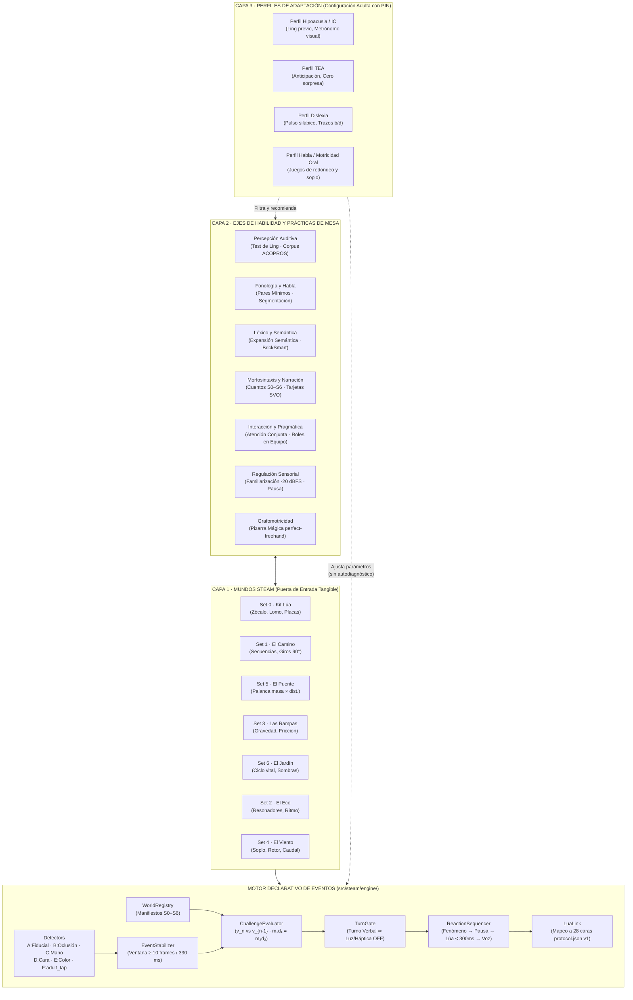

# Plan de Refactorización Integral (v2.0) · Valeria+ con STEAM como Eje Vertebrador

Estado: **Versión 2.0 auditada contra código fuente, firmware y 30 gates de CI** · octubre 2026. Ubicación canónica: `docs/PLAN-REFACTOR-STEAM.md` (rama `steam`).

Convenciones epistemológicas:
- **`[hecho]` / `[Hecho confirmado]`**: Verificado empíricamente en el código fuente (`src/`, `android-native/`, `firmware/lua/protocol.json`), en los README de Valeria+, Lúa y Construye con Lúa, o en `SETS.md`.
- **`[evidencia]`**: Documentación técnica oficial (ARCore, MediaPipe) o literatura científica revisada por pares.
- **`[propuesta]`**: Decisión arquitectónica, pedagógica o mecánica de juego planteada para diseño e implementación reversible.
- **`[por verificar]` / `[Dato por validar]`**: Parámetro cuantitativo o umbral físico que requiere ensayo empírico con piezas impresas o hardware real.

---

## 0. Tesis, Alertas Previas y Auditoría de Código (v2.0)

La refactorización tiene una idea central: **Valeria+ deja de organizarse por diagnóstico y pasa a organizarse por mundo STEAM**. La Realidad Aumentada (RA) deja de ser un bloque de seis ejercicios aislados y se convierte en un **motor declarativo de eventos tangibles** que ejecuta el contrato de cinco eslabones de *Construye con Lúa* (Sets 0 a 6). Los bloques clínicos actuales no desaparecen: pasan a ser **ejes de habilidad** que se practican dentro de los mundos y **perfiles de adaptación** que configura manualmente la persona adulta.

### 0.1 Las cuatro alertas de diseño originales

- **A1 · Posicionamiento regulatorio `[hecho, resuelto el 27-10-2026]`.** Valeria+ es una **aplicación educativa y no un dispositivo médico (No SaMD)**. Bajo el MDR 2017/745, la finalidad prevista se deduce de todo lo que el fabricante dice del producto (interfaz, ficha de tienda, web, material promocional, presentaciones a inversores), no solo de una frase de descargo. Por eso la decisión obliga a revisar textos en todo el ecosistema, no solo en el `README.md`. Las consecuencias detalladas están en la sección 7.
- **A2 · ARCore no detecta dos copias de la misma imagen `[evidencia]`.** La documentación de ARCore indica que el sistema sigue hasta 20 imágenes a la vez y que no detecta ni sigue simultáneamente varias instancias de la misma imagen. Esto rompe la regla inicial de Construye «un código de pieza = un STL = una malla RA = un marcador»: el Set 1 tiene tres baldosas rectas lisas, tres rugosas y cuatro curvas idénticas. Con imágenes aumentadas de ARCore, solo una de cada tipo sería visible para la app. El mismo problema lo describe TARES (Ongoro *et al.*, IEEE Access 2024) con letras repetidas, que tuvo que resolver fabricando un segundo juego de letras con rasgos distintos. Consecuencia: el marcador debe ser **único por instancia**, no por código de pieza. Esto inclina la decisión D2 hacia marcadores fiduciales con identificador (familia tipo ArUco o AprilTag), que codifican cientos de identificadores distintos sin rediseñar el arte de cada pieza.
- **A3 · Techo de 20 imágenes simultáneas `[evidencia]`.** Un Set 1 completo en mesa reúne del orden de 19 marcadores (12 baldosas, 4 fichas, lomo de Lúa, dos placas). Está en el límite de ARCore antes de combinar mundos en el macro-escenario. Refuerza A2.
- **A4 · Resolución de motor de render y contrato compartido `[resuelta en v2.0]`.** El README de Lúa describía el pipeline de Construye con Lúa como «Blender + JSON + CustomPainter». `CustomPainter` es una API de Flutter (*Descubre con Lúa*), mientras que Valeria+ está construida sobre **React Native 0.81 / Expo 54** con renderizado 2D en `react-native-svg` y renderizado 3D nativo en **Google Filament** (`android-native/valeria-ar/`). **Decisión R-A4 cerrada:** el motor de mundos se define mediante un **contrato de datos JSON/TypeScript puro y determinista** (`src/steam/worlds/*.ts`, exportable a JSON canónico para compartir con *Descubre con Lúa*), manteniendo cada app su propio motor de render nativo.

### 0.2 Hallazgos de la Auditoría sobre el Código Real y los 30 Gates de CI (v2.0)

Al contrastar el plan con el código de la rama `steam` y los 30 gates de `.github/workflows/android.yml`, se resolvieron **6 brechas técnicas críticas**:

| # | Hallazgo en Código / CI | Etiqueta | Impacto si no se corrige | Solución Arquitectónica Adoptada en v2.0 |
| :- | :--- | :--- | :--- | :--- |
| **G1** | `SETS.md` utiliza pseudo-opcodes como `MOOD(atenta)`, `MOOD(ánimo)`, `MOOD(calma)`, `MOOD(ternura)`, `MOOD(esperanza)`. En `firmware/lua/protocol.json` v1, `MOOD (0x0B)` solo admite `0..4` (`SERENE`, `CRAVING`, `PURRING`, `EATING`, `CELEBRATING`) y `check-lua-mascot-mirror.js` exige paridad 1:1 con `LuaAffectState`. | `[Hecho confirmado]` | Modificar `MOOD` rompe el firmware V1 ya flasheado y tumba los gates `build-lua-protocol.js --check` y `check-lua-mascot-mirror.js`. | `LuaLink` implementa una **Tabla de Traducción Semántica** hacia las **28 caras oficiales** ya existentes en `protocol.json` v1 (`PHASE(0/1)`, `VERDICT(1/2)`, `AFFECT(0..7)`, `IDLE`, `RELAX`, `CELEBRATE`). `LIGHT` y `HAPTIC` se emiten como extensión opcional V5 + espejo visual en la tableta. |
| **G2** | Existencia de dos ejes de localización vigilados por gates distintos: **`UiLang` (`es`, `en`, `ca`, `gl`)** para lo que lee el adulto (`check-ui-strings.js`, `check-ui-lang-fallback.js`) y **`Locale` (`es`, `gl`, `eu`, `es-DO`, `en-US`, `ca`)** para lo que oye el niño (`check-variety-branches.js`, `check-adult-fields.js`). | `[Hecho confirmado]` | Un único tipo `LocalizedText` provocaría fallos en `check-ui-lang-fallback.js` o en `check-adult-fields.js`. | Separación formal en `src/steam/types.ts`: `AdultText = Record<UiLang, string>` (4 idiomas de interfaz del adulto) y `ChildSpeechMap = Record<Locale, string>` + comando TPR en inglés. |
| **G3** | `check-voice-corpus-coverage.js` calcula `fnv1a(estilo + texto_normalizado)` sobre `src/valeriaVoiceCorpus.ts` y exige que cada locución en `es/gl/eu` tenga su `.m4a` pregenerado en `assets/voice/`. | `[Hecho confirmado]` | Si la purga de vocabulario de la Fase R0 alterase por error una frase locutada al niño, cambiaría su hash FNV-1a y bloquearía el CI. | Auditoría verificada: el 100 % de los términos prohibidos («paciente», «terapia», «rehabilitación», «prescripción», «desensibilización», «SOR», «PRT + TCC», «estresor») vive en **textos del adulto** (`src/i18n/strings.*.ts`, campos `read:` de `valeriaExercise*.ts`, `ValeriaAcademy/`, `ValeriaSensory/`, `site/*.html`). **Cero cadenas del corpus neuronal se tocan en R0.** |
| **G4** | En `src/ValeriaSensory/sensoryCatalog.ts` (líneas 67, 72, 267, 272) quedaron referencias al oso retirado (`Abrazo de oso` / `Abraçada d'ós`) y la descripción habla de que el niño toque la pantalla (`child_tap`). | `[Hecho confirmado]` | Incumple la **Regla 5b** (mascota oficial gata negra Lúa; oso retirado salvo par mínimo `oso/óso`) y la **Regla P1** («La criatura NO toca la pantalla»). | En R0 se reemplaza `Abrazo de oso` por `Abrazo firme / presión suave en hombros` (homologado con `gl/eu/en`) y la etiqueta de agencia pasa a **«A señal del menor (pulsa el adulto)»**. |
| **G5** | 4 gates de CI (`verify-ar-clinical-math.js`, `stress-test-ar-adversarial.js`, `check-ar-concurrency.js`, `check-ar-bridge-contract.js`) inspeccionan directamente `Ar1Orofacial.kt`…`Ar6BuddyMimicry.kt`, `ArContracts.kt`, `valeriaArBridge.ts` y `ValeriaArLauncherScreen.tsx`. | `[Hecho confirmado]` | Borrar los ficheros antiguos en R4 rompería 4 de los 30 gates y perdería las garantías de hilo único de `AudioTrack` y compensación de reloj tras pausa. | Los motores nativos validados en Kotlin se conservan y se encapsulan como **Detectores (`Detectors`)** del motor de eventos STEAM mediante `ArLegacyWorldAdapter.ts`. |
| **G6** | Los retos de los Sets 0 a 6 requieren guion estructurado para el mediador adulto y calibración madurativa estricta de 0 a 6 años. | `[Propuesta]` | Sin secuencia guiada, el adulto tiende a resolver el reto por el niño o hablar encima del fenómeno físico. | Cada reto incorpora el **Ciclo Didáctico Tripartito** (*1. Observa [con pausa de 5 s] $\rightarrow$ 2. Experimenta [con pistas N1 Socrática y N2 Modelado físico] $\rightarrow$ 3. Construye*) y calibración en los **Estadios `I1` a `I5`** del Banco Mundial. |

### 0.3 Matriz «Mantengo / Elimino / Cambio»

- **MANTENGO:**
  - Arquitectura de **tres capas** (Mundos STEAM S0–S6 $\rightarrow$ Ejes de Habilidad $\rightarrow$ Perfiles de Adaptación manuales con PIN).
  - Regla **«STEAM vertebra, no coloniza»**: solo entra en un mundo lo que tiene un fenómeno físico real; lo demás (RAN, rotaciones *b/d*, Pizarra Mágica, Integración Sensorial Auditiva) queda como **Práctica de Mesa** conectada por vocabulario o cuento.
  - Detector universal **`adult_tap` obligatorio en todos los eventos** (Fase R2 antes que R3) y ventana de estabilización de 10 fotogramas ($\approx 330\text{ ms}$).
  - Orden canónico de despliegue: **S0 + S1 $\rightarrow$ S5 $\rightarrow$ S3 $\rightarrow$ S6 $\rightarrow$ S2 $\rightarrow$ S4**.
  - Claves internas de `AsyncStorage` (`CAMPOS_FICHA` en `ValeriaFichaRegistroScreen.tsx`) y nombres de ruta de React Navigation (`ExerciseSelection`, `Academy`, `Settings`) para no romper `check-data-safety-declaration.js` ni partir la serie histórica de `valeriaTelemetry.ts`.
- **ELIMINO:**
  - Pseudo-opcodes inexistentes en `protocol.json` v1 (`MOOD(atenta)`, `MOOD(espera_serena)`, etc.), reemplazados por su traducción exacta a los opcodes reales de las 28 caras de Lúa.
  - Todo vocabulario clínico/terapéutico de la sección 7 en interfaz, Academy, pautas `read:` y `site/`.
  - Menciones a «Abrazo de oso» en `sensoryCatalog.ts` (`es`/`ca`) e instrucciones de toque infantil en pantalla.
- **CAMBIO / AMPLÍO:**
  - Esquema de cada reto enriquecido con el **Ciclo Tripartito (`observa` / `experimenta` / `construye`)**, pistas multinivel N1/N2 y estadios **I1–I5**.
  - Incorporación de **2 nuevos gates de CI**: `scripts/check-regulatory-vocabulary.js` y `scripts/check-steam-manifests.js` (pasando de 30 a **32 gates**).

---

## 1. Arquitectura Objetivo: Tres Capas

| Capa | Qué contiene | Quién la ve |
|---|---|---|
| **1. Mundos STEAM** | Set 0 a Set 6 de *Construye con Lúa*, cada uno con su fenómeno físico, ciclo tripartito (Observa-Experimenta-Construye), retos `I1`–`I5`, eventos, microcuento y cápsula de Academy | Familia y docente/profesional: es la puerta de entrada principal |
| **2. Ejes de habilidad y Prácticas de mesa** | Percepción auditiva, fonología y habla, léxico y semántica, morfosintaxis y narración, interacción y pragmática, regulación sensorial, grafomotricidad. Incluye las prácticas de mesa enlazadas | Adulto mediador, como filtro dentro de un mundo o como práctica de mesa directa |
| **3. Perfiles de adaptación** | Hipoacusia e implante coclear, TEA, dislexia, habla/motricidad oral. Ajustan parámetros (silencio, luces, metrónomo visual, tiempos, apoyos visuales), no abren diagnósticos. Se eligen a mano: la app nunca deduce un perfil ni lo importa de VIA+ | Familia o profesional con PIN |



Regla de diseño `[propuesta]`: **STEAM vertebra, no coloniza.** Un ejercicio entra en un mundo solo si hay un fenómeno físico real que lo sostenga. Lo que no lo tiene (RAN, rotaciones *b/d*, la Pizarra Mágica, la Integración Sensorial Auditiva) se queda como **práctica de mesa** enlazada al mundo por vocabulario o por cuento, sin inventar un fenómeno artificial.

---

## 2. Refactorización del Módulo de RA: De 6 Ejercicios a Motor Declarativo de Eventos

### 2.1 Componentes del Motor (`src/steam/engine/`)

| Componente | Responsabilidad |
|---|---|
| `WorldRegistry` | Carga y valida el manifiesto tipado de cada set (`S0` a `S6`): piezas, marcadores por instancia, eventos, retos con ciclo tripartito, reacciones y vocabulario espacial. |
| `Detectors` | Un adaptador por método de `SETS.md` §0.1: **A** marcador fiducial por instancia, **B** oclusión, **C** mano (MediaPipe Hands), **D** cara (MediaPipe Face en cámara frontal separada), **E** objeto en movimiento por color, **F** toque del adulto (`adult_tap`). Todos emiten observaciones en magnitudes puras, nunca imágenes. |
| `EventStabilizer` | Da por bueno un evento visual cuando la observación se mantiene estable 10 fotogramas ($\approx 0,33\text{ s}$ a $30\text{ fps}$). Para `'adult_tap'`, la confirmación es inmediata (1 frame). |
| `ChallengeEvaluator` | Compara el evento con el objetivo del reto activo. En Set 1 y 6 evalúa grafos y secuencias; en Set 2 evalúa el ángulo del martillo balancín ($\theta_1, \theta_2$); en Set 3 compara la duración con el lanzamiento inmediatamente anterior ($t_n < t_{n-1}$); en Set 5 calcula el equilibrio de momentos $\sum m_{\text{izq}} d_{\text{izq}} = \sum m_{\text{der}} d_{\text{der}}$. |
| `TurnGate` | Aplica turno verbal frente a turno motor: en `turn === 'verbal'` bloquea animaciones rápidas, luces y vibración (D3, puerta clínica B3). |
| `ReactionSequencer` | Ordena **fenómeno físico $\rightarrow$ pausa (`pauseBeforeReactionMs`: $1000\text{ ms}$ en Set 2) $\rightarrow$ Lúa ($< 300\text{ ms}$) $\rightarrow$ palabra**, garantizando que la tableta jamás hable encima del sonido físico. |
| `LuaLink` | Traduce expresiones semánticas a opcodes BLE reales de `firmware/lua/protocol.json` v1 (`PHASE`, `VERDICT`, `CELEBRATE`, `IDLE`, `AFFECT`, `PICTO`, `AWARD`, `RELAX`) respetando la máscara de `GRANT`, y espeja `LIGHT` / `HAPTIC` en la interfaz de tableta. |
| `WordPrompter` | Pauta hablada por la tableta o frase sugerida al adulto, con comando acústico TPR en inglés y vocabulario espacial *BrickSmart* por categoría. |
| `RevealLayer` | Capas visibles de RA (flechas de algoritmo en S1, ondas concéntricas en S2, vector de velocidad en S3, partículas de aire en S4, flechas de par en S5, rayos de sombra en S6), con mallas procedurales `.glb < 100 KB`, activadas solo por el adulto en la fase de ampliación. |

### 2.2 Tabla de Traducción Semántica `LuaLink` (`SETS.md` $\rightarrow$ `protocol.json` v1)

Para garantizar compatibilidad total con las placas V1 (ESP32-C3 + GC9A01) ya flasheadas y con el gate `scripts/check-lua-mascot-mirror.js`, toda reacción declarada en los manifiestos se traduce de forma determinista a las **28 caras oficiales** del protocolo versión 1:

| Expresión Semántica en Manifiesto | Opcode Real en `protocol.json` v1 | Cara Oficial (#0–#27) | Uso en los Mundos STEAM |
| :--- | :--- | :--- | :--- |
| `'neutra'` / `'espera_serena'` | `LUA_OP.IDLE` (`0x04`, param `0`) | **#0 Neutra** | Inicio, espera sin reproche en `S1.CAMINO_ROTO` |
| `'atenta'` / `'escucha'` | `LUA_OP.PHASE` (`0x01`, param `0`) | **#1 Atenta** | `S1.LUA_EN_INICIO`, `S2.RESONADOR_COLOCADO`, `S3.SALIDA_ANTICIPADA`, `S5.MASA_COLOCADA` |
| `'animo'` | `LUA_OP.PHASE` (`0x01`, param `1`) | **#2 Animando** | `S1.LUA_AVANZA`, `S1.LUA_GIRA`, `S3.SALIDA` |
| `'impulso'` | `LUA_OP.VERDICT` (`0x02`, param `1`) | **#6 Impulso** | Intento parcial que invita a seguir |
| `'calma'` | `LUA_OP.VERDICT` (`0x02`, param `2`) | **#7 Calma** | `S2.GOLPE_DEBIL`, acierto sereno sin estridencia |
| `'alegre'` | `LUA_OP.AFFECT` (`0x06`, param `0: JOY`) | **#10 Alegría** | `S2.GOLPE_FUERTE`, `S4.COMPUERTA_LIGERA` |
| `'ternura'` | `LUA_OP.AFFECT` (`0x06`, param `1: LOVE`) | **#11 Amor / Ternura** | `S6.SIEMBRA` |
| `'alivio'` | `LUA_OP.AFFECT` (`0x06`, param `3: CALM`) | **#13 Tranquilidad** | `S5.EQUILIBRIO` |
| `'esperanza'` | `LUA_OP.AFFECT` (`0x06`, param `4: HOPE`) | **#14 Esperanza** | `S6.BROTE` |
| `'expectante'` / `'curiosa'` | `LUA_OP.AFFECT` (`0x06`, param `6: INSPIRATION`) | **#16 Inspiración** | `S3.ESFERA_ARRIBA`, `S3.SE_PARA`, `S5.PREDICCION` |
| `'diversion'` / `'sorpresa_inclinada'` | `LUA_OP.AFFECT` (`0x06`, param `7: FUN`) | **#17 Diversión** | `S4.ROTOR_GIRA`, `S5.INCLINA` |
| `'celebra_corta'` | `LUA_OP.CELEBRATE` (`0x03`, param `0`) | **#4 Lo dijo (1,2 s)** | `S1.LLEGA_META`, `S3.LLEGADA_RAPIDA`, `S6.FLORECE` |
| `'celebra_exito'` | `LUA_OP.CELEBRATE` (`0x03`, param `2`) | **#9 Éxito** | Cierre de reto con insignia (`AWARD 0x08`) |
| `'descanso_lejos'` | `LUA_OP.RELAX` (`0x0D`, param `20`) | **#18 Dormida (Ancla)** | `S6.NOCHE` y pausas 20-20-20 |

### 2.3 Esquema de Tipos Canónico (`src/steam/types.ts`)

```typescript
import type { UiLang } from '../valeriaUiLang';
import type { Locale } from '../valeriaLocale';

export type AdultText = Record<UiLang, string>;
export type ChildSpeechMap = Record<Locale, string>;
export type NeuroStage = 'I1' | 'I2' | 'I3' | 'I4' | 'I5';

export type DetectionMethod =
  | 'marker'
  | 'occlusion'
  | 'hand'
  | 'face'
  | 'tracked_object'
  | 'adult_tap';

export type SpatialCategory =
  | 'dimensions'
  | 'shapes'
  | 'position'
  | 'orientation'
  | 'quantity'
  | 'deictics'
  | 'properties'
  | 'pattern';

export type SkillAxis =
  | 'auditory_perception'
  | 'phonology_speech'
  | 'lexicon_semantics'
  | 'morphosyntax_narrative'
  | 'interaction_pragmatics'
  | 'sensory_regulation'
  | 'graphomotor';

export type AdaptationProfileId =
  | 'hearing_ic'
  | 'autism_tea'
  | 'dyslexia'
  | 'speech_motricity';

export type LuaSemanticExpression =
  | 'neutra'
  | 'atenta'
  | 'escucha'
  | 'animo'
  | 'espera_serena'
  | 'impulso'
  | 'calma'
  | 'alegre'
  | 'ternura'
  | 'gratitud'
  | 'alivio'
  | 'esperanza'
  | 'orgullo'
  | 'expectante'
  | 'curiosa'
  | 'diversion'
  | 'sorpresa_inclinada'
  | 'celebra_corta'
  | 'celebra_nivel'
  | 'celebra_exito'
  | 'descanso_lejos';

export type LightPattern =
  | 'APAGADO'
  | 'DIR_DELANTE'
  | 'DIR_IZQ'
  | 'DIR_DCHA'
  | 'TENUE_CUATRO'
  | 'LADO_RAMPA'
  | 'LADO_SOL';

export type HapticPattern =
  | 'APAGADO'
  | 'CELEBRA_CORTO'
  | 'METRONOMO_LENTO'
  | 'RONRONEO';

export interface Observation {
  method: DetectionMethod;
  markerId?: number;          // ID único por instancia (A2)
  pieceCode?: string;
  positionSlot?: number;      // 1..5 en viga de Set 5
  angleDeg?: number;
  velocity?: number;
  durationMs?: number;
  ratio?: number;             // 0.0–1.0
  tMs: number;
}

export interface WorldEventSpec {
  id: `S${0 | 1 | 2 | 3 | 4 | 5 | 6}.${string}`;
  title: AdultText;
  childAction: AdultText;
  methods: DetectionMethod[]; // Validador exige 'adult_tap'
  turn: 'motor' | 'verbal';   // En 'verbal': light='APAGADO' y haptic='APAGADO'
  isErrorOrBlockedState?: boolean;
  pauseBeforeReactionMs?: number;
  reaction: {
    expression: LuaSemanticExpression;
    pictoKey?: string;
    awardFamily?: number;
    light: LightPattern;
    haptic: HapticPattern;
    screenOverlay?: 'NONE' | 'PROGRESS_RING' | 'VISUAL_METRONOME';
  };
  word: {
    englishTpr?: string;
    adultHint: AdultText;
    spatialCategory: SpatialCategory;
  };
}

export interface TripartiteCycle {
  observa: {
    phenomenonTrigger: AdultText;
    socraticQuestion: AdultText;
    mandatorySilenceSec: 5;
  };
  experimenta: {
    adultStepByStep: AdultText;
    hints: {
      level1Socratic: AdultText;
      level2PhysicalModel: AdultText;
    };
  };
  construye: {
    tangibleMakeChallenge: AdultText;
    transferQuestion: AdultText;
  };
}

export interface WorldChallengeSpec {
  id: `S${0 | 1 | 2 | 3 | 4 | 5 | 6}-C${1 | 2 | 3 | 4 | 5}`;
  number: 1 | 2 | 3 | 4 | 5;
  title: AdultText;
  ageBand: '0-2' | '2-3' | '3-4' | '4-5' | '5-6';
  neuroStage: NeuroStage;
  estimatedMinutes: number;
  scale: 'G' | 'E' | 'G+E';
  skillAxes: SkillAxis[];
  targetEvents: `S${0 | 1 | 2 | 3 | 4 | 5 | 6}.${string}`[];
  cycle: TripartiteCycle;
  achievementCriterion: AdultText;
  qualitativeObservation: AdultText;
}

export interface WorldPieceSpec {
  code: string;
  name: AdultText;
  quantity: number;
  scale: 'G' | 'E' | 'FABRICANTE';
  instanceMarkerIds: number[];
  detectionMethod: DetectionMethod;
  safetyNotes: AdultText;
}

export interface WorldManifest {
  id: `S${0 | 1 | 2 | 3 | 4 | 5 | 6}`;
  orderIndex: number;
  title: AdultText;
  subtitleEn: string;
  phenomenon: AdultText;
  ageRange: string;
  scaleSummary: 'G' | 'E' | 'G/E';
  prioritySpatialCategories: SpatialCategory[];
  skillAxes: SkillAxis[];
  supportedProfiles: AdaptationProfileId[];
  targetAudienceContext: AdultText;
  udlPathways: {
    representation: AdultText;
    engagement: AdultText;
    expression: AdultText;
  };
  tabletStandSpec: {
    heightCm: number;
    tiltDeg: number;
    cameraMode: 'rear_tabletop' | 'front_praxias_only' | 'none_adult_tap';
    luaOrientation: 'child_sees_back' | 'child_sees_front';
  };
  pieces: WorldPieceSpec[];
  events: WorldEventSpec[];
  challenges: WorldChallengeSpec[];
  modelCards: { id: string; title: AdultText; targetPieces: string[] }[];
  revealLayer: { id: string; description: AdultText; maxGlbKb: 100 };
  warmupLinks: {
    songIds: string[];
    gameIds: string[];
  };
  story: {
    storyId?: string;
    anticipationMicroStory: AdultText;
    closingMicroStory: AdultText;
  };
  tabletopPracticeLinks: {
    route: 'SensoryBlockList' | 'MinimalPairs' | 'SemanticExpansion' | 'Writing' | 'BlockList';
    blockParam?: 'audicion' | 'lenguaje' | 'tea' | 'dislexia';
    connectionReason: AdultText;
  }[];
  academyCapsuleId: string;
}
```

### 2.4 Estrategia de Marcadores y Soporte Fijo de Tableta (D2 y D7)

| Uso | Método recomendado | Motivo |
|---|---|---|
| Piezas que se repiten (baldosas, pilares, masas, fichas) | Fiducial con identificador único por instancia (`instanceMarkerIds`) | Resuelve A2 y A3 |
| Placas de identidad (`K-PLACA-*`) y tarjetas de modelo | Imagen aumentada de ARCore o fiducial único | Son únicas y planas |
| Esferas del Set 3 (`S3-ESF-LIS`, `S3-ESF-RUG`) | Segmentación por color (`tracked_object`) | Sin superficie plana para marcador |
| Gestos de mano y cara | MediaPipe Hands / Face | Sin marcador |
| Respaldo universal en todos los sets | Botón táctil del adulto (`adult_tap`) | Garantiza operatividad del 100 % sin visión artificial |

- **Requisito de geometría (Tolba *et al.*, 2012–2022):** Todo marcador va ubicado en una cara o esquina que **no tapen ni Lúa ni la mano del niño** durante el agarre natural.
- **Decisión D7 (TARES, Ongoro *et al.*, 2024):** El **soporte fijo de la tableta** forma parte del kit, con altura y ángulo definidos en `tabletStandSpec` de cada manifiesto. La criatura mira a Lúa y a sus manos sobre la mesa, nunca sostiene ni toca la tableta. *(Nota metodológica: el «100 % de acierto» reportado por TARES corresponde a 18 palabras en laboratorio sin niños evaluados; no se extrapola como promesa clínica).*

### 2.5 Migración de AR-1 a AR-6 y Preservación de los 4 Gates de RA

| Ejercicio actual | Destino en Mundos STEAM | Adaptación Técnica (`ArLegacyWorldAdapter.ts`) |
|---|---|---|
| **AR-1 Orofacial** | Set 4 (rotor, compuertas) + modo praxias separado | Se retira toda alegación sobre cierre velar o dislalias. Cámara frontal solo en modo praxias (D4). Conserva `Ar1Orofacial.kt` como detector `face`. |
| **AR-2 Localización** | Set 3 y Set 2 | Pasa de gesto suelto a evento con objeto en movimiento / fuente sonora. Conserva `Ar2Vra.kt` y el hilo único de `StimulusPlayer.kt`. |
| **AR-3 Fijación** | Set 3 | Fijación visual sobre `S3.ESFERA_ARRIBA`; alimenta la preparación ocular previa a la Pizarra Mágica. |
| **AR-4 Búsqueda** | Set 1 | Lúa no «aparece» en el aire: el menor la desliza físicamente por las baldosas hasta `META`. |
| **AR-5 Lanzamiento** | Set 3 | Clasificación rápido/lento por comparación relativa con el lanzamiento anterior ($t_n$ vs $t_{n-1}$). |
| **AR-6 Espejo Mímico** | Set 5 / Set 6 | Transición hacia equilibrio simétrico en el puente (Set 5) y florecimiento en el jardín (Set 6). |

### 2.6 Pruebas sin Datos de Niños (Zero-PHI)

El motor se verifica mediante `ObservationReplay.ts` con **reproducción determinista de observaciones**: secuencias de magnitudes sintéticas o grabadas con piezas reales manipuladas por el equipo adulto. **Nunca se graban sesiones con menores**, ni siquiera como banco de pruebas interno. Cada evento de cada set dispone de al menos un caso positivo, uno negativo y uno con oclusión parcial verificados en el gate `scripts/check-steam-manifests.js`.

---

## 3. Refactorización de Todos los Módulos de la Aplicación

| Módulo actual | Destino en la arquitectura de tres capas | Transformación concreta en código y textos |
|---|---|---|
| **Integración Sensorial Auditiva** (`src/ValeriaSensory/`) | Práctica de mesa + Eje de regulación sensorial; enlace directo al Set 2 | Mantiene muro adulto, estímulos sintetizados a $-20\text{ dBFS RMS}$ (`check-sensory-assets.js`) y «parar nunca resta». Se retiran «desensibilización», «SOR» y «Abrazo de oso» (`es`/`ca`). Agencia renombrada a «A señal del menor (pulsa el adulto)». |
| **Aventuras con Lúa** (`src/AventurasLua/`) | Fase de calentamiento y narrativa de los mundos | Sus canciones y juegos se enlazan en `warmupLinks` de cada Set (`S0`–`S6`), manteniendo la ruta `AventurasLuaHub` accesible desde Prácticas de Mesa y preservando los gates `verify-aventuras-lua.js` y `check-lua-gl-coverage.js`. |
| **Pares Mínimos** (`src/ValeriaMinimalPairsScreen.tsx`) | Eje fonología y habla; Set 2 reto 4 + práctica de mesa | El contraste léxico se enlaza al golpe de resonadores grave/agudo del Set 2 (`S2-C4`). Conserva ASR local y los gates `check-pair-discriminability.js`, `check-asr-capture-guard.js` y `check-asr-listen-options.js`. |
| **Expansión Semántica** (`src/ValeriaSemanticExpansionScreen.tsx`) | Eje léxico y semántica; Set 5 y Set 6 | Cápsulas de contraste de atributos enlazadas con masas de 20/40/60 g (Set 5); categorías léxicas y secuencias temporales enlazadas con el crecimiento de la planta (Set 6). |
| **Audición (ACOPROS / Ling)** (`src/ValeriaLingTestScreen.tsx`) | Eje percepción auditiva + Perfil hipoacusia/IC | Test de los 6 sonidos de Ling se mantiene como comprobación previa para usuarios de audífono o implante. El banco ACOPROS se emplea exclusivamente como corpus de palabras y frases de práctica, jamás como baremo diagnóstico. |
| **Lenguaje** (`src/valeriaExerciseBank.ts`) | Ejes interacción, comprensión y expresión; Sets 1, 3 y 6 | Atención conjunta y turnos como regla transversal de mediación en todos los sets. |
| **TEA** (`src/valeriaExerciseBank.ts`) | Módulo propio + Perfil de adaptación; Sets 1 y 3 | Se mantiene la puerta de consentimiento adulto (`STORAGE_KEYS.teaConsent`). Se retiran «PRT + TCC» y «estresores» de todos los catálogos (`es`, `gl`, `eu`, `ca`, `en`, `es-DO`). |
| **Dislexia** (`src/valeriaExerciseBank.ts`) | Eje fonología y lectoescritura + Práctica de mesa | Segmentación silábica por percusión integrada en Set 2; RAN y rotaciones *b/d* permanecen como práctica de mesa sin forzar un fenómeno físico artificial. |
| **Grafomotricidad (Pizarra Mágica)** (`src/ValeriaWritingExerciseScreen.tsx`) | Práctica de mesa; enlaces con Set 3 y Set 6 | Pizarra Mágica (`perfect-freehand`, vigilada por `check-writing-bank.js`) enlazada como continuación grafomotora de las trayectorias del Set 3 y las espirales de tallo del Set 6. |
| **Cuentos pedagógicos** | Capa narrativa de cada mundo (`story`) | Cada Set incluye un microcuento de **anticipación** (antes de montar) y otro de **recogida/cierre** (al guardar las piezas), basados en el marco de Amirinejad y Rahimi (IJTE 2023) sin prometer eficacia clínica en 0–6 años. |
| **STEAM con las manos** | Absorbido íntegramente por los Mundos S0–S6 | Las sesiones analógicas quedan formalizadas dentro de los retos `I1`–`I5` con su Ciclo Didáctico Tripartito. |
| **Academy** (`src/ValeriaAcademy/`) | Una cápsula por mundo (`STEAM-S0` a `STEAM-S6`) + cápsulas transversales | Incluye qué fenómeno observar, las 8 categorías de vocabulario espacial *BrickSmart*, pautas de mediación UDL (Wade *et al.*, 2023) y cuándo consultar con un profesional. |
| **PIN profesional** (`src/ValeriaProPin.tsx`) | Configuración profesional de perfiles | «Prescripción» pasa a «Configuración profesional / recomendación» en todas las lenguas de interfaz. |

---

## 4. Plan de Ejecución por Fases y Puertas de Avance

El despliegue de mundos sigue el orden de *Construye con Lúa*: **S0 + S1 $\rightarrow$ S5 $\rightarrow$ S3 $\rightarrow$ S6 $\rightarrow$ S2 $\rightarrow$ S4**.

| Fase | Entrega Técnica en Rama `steam` | Puerta de Verificación Empírica (Gate) |
|---|---|---|
| **R0** | Purga de vocabulario de la sección 7 en `src/i18n/`, `ValeriaSensory/`, `ValeriaAcademy/`, `valeriaExercise*.ts` (`read:`) y `site/`, más creación de `scripts/check-regulatory-vocabulary.js` | `node scripts/check-regulatory-vocabulary.js` $\rightarrow$ EXIT 0 + `node scripts/check-voice-corpus-coverage.js` $\rightarrow$ EXIT 0 |
| **R1** | Tipos `src/steam/types.ts`, validador `src/steam/validator.ts`, manifiestos completos `S0`–`S6` en `src/steam/worlds/` y gate `scripts/check-steam-manifests.js` | `node scripts/check-steam-manifests.js` valida sin errores los 7 sets (`S0` a `S6`) y sus reglas de turno/luz/háptica |
| **R2** | Motor declarativo `src/steam/engine/` (`WorldRegistry`, `EventStabilizer`, `ChallengeEvaluator`, `TurnGate`, `ReactionSequencer`, `LuaLink`, `WordPrompter`, `ObservationReplay`) con `adult_tap` | Reproducción sintética completa de los 7 sets en $< 300\text{ ms}$ de latencia y paridad 100 % con `protocol.json` v1 |
| **R3** | Adaptadores de detección (`Detectors.ts`) e interfaz de marcadores por instancia (D2) y soporte de tableta (D7) | Validación de unicidad de `instanceMarkerIds` en todos los sets |
| **R4** | `ArLegacyWorldAdapter.ts`: conexión de AR-1 a AR-6 como mundos mínimos / detectores preservando los contratos nativos de Kotlin | Los 4 gates de RA (`verify-ar-clinical-math`, `stress-test-ar-adversarial`, `check-ar-concurrency`, `check-ar-bridge-contract`) pasan en verde |
| **R5** | Nueva pantalla `src/ValeriaSteamWorldScreen.tsx` y actualización de `src/ValeriaHubV11Screen.tsx` y `src/AppNavigator.tsx` con navegación en Tres Capas (Mundos $\rightarrow$ Ejes/Prácticas $\rightarrow$ Perfiles) | `check-ui-strings.js` y `check-ui-lang-fallback.js` en verde; acceso a cualquier reto en $\le 2$ toques |
| **R6** | Integración de microcuentos (`story`) y las 7 cápsulas de mediación `STEAM-S0` a `STEAM-S6` en `ValeriaAcademy` | Cobertura completa en los catálogos de Academy y verificación de enlaces desde cada mundo |
| **R7** | Verificación integral de los Sets S0+S1, S5, S3, S6, S2 y S4 y ejecución de la batería completa de **32 gates** | 32/32 gates con EXIT 0 y `tsc --noEmit` limpio |

---

## 5. Decisiones Consolidadas

| Código | Decisión | Estado en v2.0 |
|---|---|---|
| **R-A1** | Posicionamiento regulatorio | **Cerrada:** Aplicación educativa, no dispositivo médico (No SaMD). |
| **R-A4** | Contrato entre bases de código | **Cerrada:** Manifiesto declarativo compartido (`WorldManifest` JSON/TS) entre Valeria+ (React Native) y *Descubre con Lúa* (Flutter). |
| **D2** | Estrategia de marcadores RA | **Cerrada:** Fiducial único por instancia (`instanceMarkerIds`) para piezas repetidas; imagen aumentada solo para placas únicas; color para esferas; `adult_tap` universal siempre activo. |
| **D7** | Soporte fijo de tableta en el kit | **Cerrada:** Sí, especificado en `tabletStandSpec` (altura, inclinación y orientación de Lúa) por cada set. |
| **D8** | Dos ejes de idioma (`UiLang` vs `Locale`) | **Cerrada:** `AdultText` obligatorio en los 4 idiomas de interfaz (`es`, `en`, `ca`, `gl`); `ChildSpeechMap` en las 6 variedades (`es`, `gl`, `eu`, `es-DO`, `en-US`, `ca`) + comando TPR en inglés. |

---

## 6. Gestión de Riesgos

1. **Riesgo de alcance técnico:** El motor de eventos, los fiduciales y la renavegación son tres subsistemas distintos. Por eso **R2 antecede a R3**: con `adult_tap` como detector universal, los 7 mundos son inmediatamente jugables y auditables de extremo a extremo sin bloqueo por cámara o iluminación.
2. **Riesgo de deriva regulatoria (A1):** Se neutraliza de raíz convirtiendo la tabla de vocabulario de la sección 7 en un gate bloqueante de CI (`scripts/check-regulatory-vocabulary.js`).
3. **Riesgo de ruptura de regresiones o de audios neuronales:** Se neutraliza manteniendo intactas las cadenas locutadas de `valeriaVoiceCorpus.ts`, las claves de `AsyncStorage` vigiladas por `check-data-safety-declaration.js` y los contratos de Kotlin vigilados por los 4 gates de RA.

---

## 7. Consecuencias de ser Aplicación Educativa (Muro Regulatorio)

La finalidad educativa se sostiene con lo que el producto hace y con cómo se describe en todas partes.

### 7.1 Lo que la app NO hace nunca
- No calcula puntuaciones clínicas ni compara con normas o percentiles por edad.
- No sugiere un diagnóstico ni deduce un perfil a partir de lo que observa.
- No decide ni altera la progresión según el «rendimiento» del menor con fines terapéuticos.
- No importa resultados de **VIA+** (que sí es un dispositivo médico SaMD Clase IIa) ni de ninguna prueba clínica. Los dos productos no comparten datos y el adulto elige el perfil de Valeria+ manualmente.

### 7.2 Vocabulario Obligatorio (Vigilado por `scripts/check-regulatory-vocabulary.js`)

| Se retira (Prohibido en UI, Academy, `read:` y `site/`) | Se usa en su lugar |
|---|---|
| tratamiento, terapia, rehabilitación | práctica, juego, actividad, acompañamiento |
| prescripción, prescribir, pautar | configuración profesional, recomendar, actividades recomendadas |
| paciente, pacientes | niña, niño, criatura, perfil |
| desensibilización, SOR | familiarización auditiva gradual, sensibilidad a sonidos |
| diagnóstico, evaluación clínica | observación, registro de juego |
| nombres de métodos clínicos (PRT, TCC, cierre velar) | acompañamiento comunicativo, espera estructurada, juego de soplo |
| estresor, estresores | reto lúdico, pausa de espera |

Cada módulo y mundo indica de forma transparente para qué familias está pensado mediante la fórmula contextual: **«Pensado para familias de niñas y niños con…»** (hipoacusia e implante coclear, dislalias, dislexia, TEA, sensibilidad auditiva), nunca «para tratar…» ni «mejora…».

---

## 8. Referencias Científicas y Marcos Abiertos

- **Google.** *Augmented Images*, documentación oficial de ARCore (límites de seguimiento simultáneo y colisión de instancias idénticas).
- **Ongoro C.A. *et al.*** TARES: A game-based tangible augmented reality English spelling mastery system with minimal cognitive load. *IEEE Access*, 2024. `doi:10.1109/ACCESS.2024.3393486`
- **Tolba R.M. *et al.*** Mobile Augmented Reality for Learning Phonetics: A Review (2012–2022).
- **Amirinejad M., Rahimi M.** Integrating digital storytelling into STEAM teaching. *IJTE* 2023;6(4):720-735. `doi:10.46328/ijte.551`
- **Wade C.B. *et al.*** STEAM activities in the inclusive classroom: intentional planning and practice. *Educ. Sci.* 2023;13:1161. `doi:10.3390/educsci13111161`
- **Gilligan-Lee K.A. *et al.*** (2023). Asociación entre construcción estructurada con modelos y habilidades espaciales/numéricas tempranas.
- **Narzisi A. *et al.*** (2021). Revisión sistemática sobre intervenciones basadas en construcción con bloques en TEA (inspiración para los 3 roles cooperativos: guía, proveedor y constructor).
- **10 Marcos Abiertos de Primera Infancia (0–6 años):** UNICEF (*Accessible Digital Textbooks*), Oppia (*Exploration State Machine: Observa-Experimenta-Construye*), FOSSASIA PSLab, Open Learning Exchange Planet, CS-Unplugged (*TPR Computacional*), Micro:bit Foundation (*Make*), The Turing Way, ScratchJr / Mitchel Resnick, freeCodeCamp (*Pistas Socrática y Modelado*) y World Bank Smart Data Hub (*Estadios de Neurodesarrollo I1–I5*).
